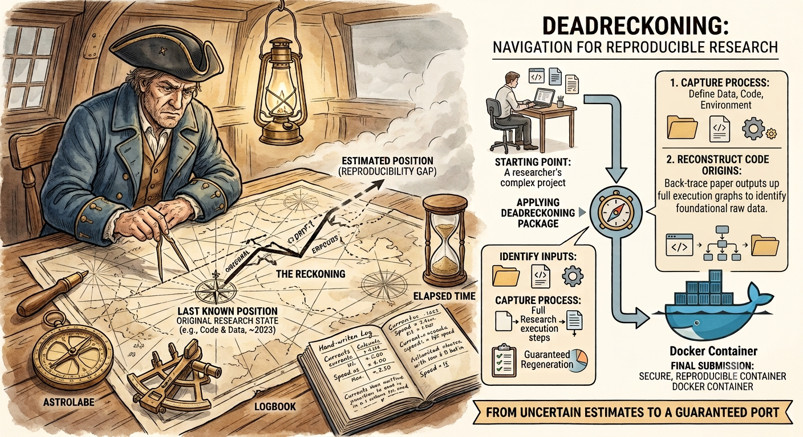

# DeadReckoning

[](https://github.com/floswald/DeadReckoning/actions/workflows/ci.yml)

> **Dead reckoning** *(navigation)*: the process of estimating one's current position based on a previously known position, then accounting for speed, direction, and elapsed time — without access to external reference points such as GPS. Accurate fixes require cross-referencing multiple imperfect signals. The further you have drifted from the last known position, the harder the reckoning.

**What it's for:** you're an economics (or other empirical) researcher, your paper just got accepted, and the journal wants a replication package. You try to rerun everything and it doesn't work anymore — moved files, changed package versions, a figure nobody remembers how to regenerate. DeadReckoning reads your project, asks you the handful of things it genuinely can't figure out on its own, fixes what it can (including using an LLM to diagnose and repair a broken run), and hands you back a working replication package plus a Docker setup for submission.



---

## Installation

Requires Python 3.11+ and `git`. Not yet on PyPI — install from source:

```bash
git clone https://github.com/floswald/DeadReckoning.git
cd DeadReckoning
pip install -e .
```

(A virtualenv or conda environment is recommended, but not required.)

**Optional, depending on what your project needs:**

- `ANTHROPIC_API_KEY` set in your environment — enables the automated fix loop (an LLM diagnoses and repairs a run that fails natively; without it, that step is silently skipped and you're on your own for that failure).
- Docker Desktop (or another Docker daemon) — only needed for the containerization steps at the end of the pipeline; everything up to a working native replication package runs without it.
- Stata / MATLAB installed locally, if your project uses them — DeadReckoning detects and drives them, but can't install them for you (proprietary, license-locked).

## Quick start

```bash
deadreckoning run /path/to/your/project
```

This is the main command:

1. Asks you a short intake questionnaire first — including, up front, whether any of your data is confidential or restricted (see [§4](#4-confidentiality-and-restricted-data) for why that's asked before anything else happens).
2. Makes a full copy of your project to work in — **your original files are never touched.**
3. Reads your paper's `.tex` source, traces every figure/table back to the script and data that produce it, and flags anything that doesn't trace cleanly.
4. Tries to actually run your code natively, fixes what it can (including handing a real failure to an LLM to diagnose, if `ANTHROPIC_API_KEY` is set), and reports what worked.
5. Optionally builds and validates a Docker image on top, once the native run passes.

Useful flags:
- `--skip-docker` / `--no-skip-docker` — Docker is skipped by default; enable it once your native run passes.
- `--answers-file answers.json` — supply the intake questionnaire's answers non-interactively (for scripted/CI use).
- `--skip-intake` — bypass the questionnaire entirely; relies only on filename-based restricted-data detection.
- `--stop-after STEP` — halt right after the named step (see pipeline steps below); useful for inspecting intermediate state one step at a time.
- `--json` — machine-readable output.

### Pipeline steps

```
DETECT → GRAPH → CAPTURE → SCAN → RESOLVE → ASK → FIX → LLM-FIX → RUN (native) → VALIDATE (native)
  → CLEAN → RNG-CHECK → MIXED-LANGUAGE-CHECK → SORT-CHECK → FIDELITY → GENERATE → BUILD (docker) → VALIDATE (docker) → DELIVER
```

| Step | What it does | Blocking? | Output file |
|------|--------------|-----------|--------------|
| **DETECT** | Filename-only restricted-data check, before any file is opened | Yes — can abort before the working copy is even made | — |
| **GRAPH** | Parse `paper.tex` + scripts into exhibits / data files / gaps | Partially (some gap kinds feed a blocking ASK question) | — (feeds `DATA-EXHIBIT-MAP.md`, written separately) |
| **CAPTURE** | Infer language / packages / confidence from lockfiles or a static scan | No | — |
| **SCAN** | Extract external paths, secrets, and package refs from every script | No | — |
| **RESOLVE** | Rewrite external/absolute paths to project-relative ones | No | — |
| **ASK** | Surface gaps that need the author | Yes, for 5 specific gap kinds (see below) | `QUESTIONS.md` |
| **FIX (deterministic)** | Apply the one fix it can make without an LLM | No | fix report in `AGENT_REPORT.md` |
| **LLM-FIX** | Claude proposes a fix from a real stderr | No (only engages after a real failure) | `AGENT_REPORT.md` |
| **RUN (native)** | Execute the master script | — | — |
| **VALIDATE (native)** | Check every exhibit exists on disk | — | — |
| **CLEAN** | Flag files unreachable from any exhibit | No | `CLEANUP.md` |
| **RNG-CHECK** | Flag an unseeded stochastic call | No | `RNG-WARNINGS.md` |
| **MIXED-LANGUAGE-CHECK** | Flag Rcpp/Cython/MEX with no declared build step | No | `MIXED-LANGUAGE-WARNINGS.md` |
| **SORT-CHECK** | Flag a nondeterministic Stata sort feeding a tie-sensitive op | No | `SORT-WARNINGS.md` |
| **FIDELITY** | Content-hash regenerated exhibits against author-supplied reference exhibits; localize a mismatch | No — but only runs at all if `reference_exhibit_dirs` was given at intake | `FIDELITY-REPORT.md` (written whenever it runs, clean pass or not) |
| **COMPILE-CHECK** *(runs during GRAPH/ASK, not CLEAN)* | Standalone Fortran/C/C++ source with no build script | Yes | — (feeds a blocking ASK question) |
| **GENERATE** | Write the Dockerfile (skipped by default) | — | `Dockerfile`, `.dockerignore` |
| **BUILD (docker)** | Build the image | — | — |
| **VALIDATE (docker)** | Re-run and validate inside the container | — | — |
| **DELIVER** | Write the final README + report + zip | — | `README`, `DELIVERY_REPORT.md`, `.zip` |

Each of these is explained in full below — exact mechanism, what it will and won't catch, and a worked example. If you just want to run the tool, the table above is enough; read on if you want to know precisely what each check is doing before you trust it.

`--stop-after` currently accepts `detect`, `graph`, `capture`, `scan`, `resolve`, `ask`, `fix`, `llm-fix`, `run`, or `validate` — CLEAN onward aren't individually stoppable yet, since they only run when Docker isn't skipped.

### Tool reference

#### DETECT — `confidentiality.py`

The first thing that runs, before any file is opened or any copy made. Pure filename/stem matching — it never reads file contents. Two regex sets: a literal-substring list (`restricted`, `confidential`, `nda`, `hipaa`, `pii`, `microdata`, `census`, `irs`, `hmda`, `nlsy`, `psid`, `sipp`, `acs_pums`, …) and a contextual pattern for the word "admin" (`admin(?:istrative)?[_-]?(?:data|records?|microdata|panel)`) so a bare "admin" in a filename doesn't false-positive. Code/doc/output extensions (`.R`, `.py`, `.tex`, `.pdf`, …) are excluded from matching entirely — this is deliberately conservative to avoid false positives on things like a citation file.

- **Blocking:** yes. A hit aborts before the working copy is made (or triggers a re-confirmation prompt).
- **Example:** `census_microdata_2019.dta` → flagged (`microdata` substring). `census_add_toutain.Rd` → not flagged (`.Rd` is an excluded extension), even though "census" appears in the name.

#### GRAPH — `graph.py`

The largest module in the codebase, and the one everything else depends on. No AST, no LLM — pure regex, but a lot of it. It reads `paper.tex` for every `\includegraphics`/`\input`/`\include`/`\lstinputlisting`/`\includesvg` (and a handful of data-table macros), expanding any `\newcommand`/`\def` aliases first, to build the authoritative **exhibit list**. For each exhibit path, it tries to find the script that writes it, in three tiers:

1. **Exact match** — some script's extracted write-call (`ggsave(...)`, `graph export ...`, `save ...dta`, `to_csv(...)`, etc. — one regex family per language) writes to that exact path.
2. **Basename match** — no exact match, but some script writes a file with the same name in a different directory → flagged as `script_writes_wrong_path` (this is the one gap FIX can repair deterministically, below).
3. **Copy/rename trace** — still nothing, but a `cp`/`shutil.copy`/Stata `copy`/`file.rename` call anywhere connects an existing write to the exhibit path one or more hops upstream.

Data-file *reads* (`read.csv`, `use`/`import delimited`, `read_csv`, `CSV.read`, …) are extracted the same way and linked to whichever script's write-call produced them, which is what populates `DataFile.produced_by`. `script_order` (used by RNG-CHECK and by the demos' native-run loop) is a topological sort over those producer→consumer edges — not alphabetical, and not the order scripts appear in the paper.

- **Blocking:** four gap kinds here are blocking (`exhibit_no_source_script`, `exhibit_missing_from_disk`, `exhibit_copied_but_no_source_script`, `input_missing_from_disk`); inline hand-typed tables/numbers in the `.tex` are flagged but non-blocking.
- **Example:** `code/stata/prep.do` contains `save "data/x.dta", replace` → `DataFile(path=data/x.dta, produced_by=code/stata/prep.do)`. If `paper.tex` has `\input{output/Table1.tex}` and some script instead writes `output/table1.tex` (case mismatch), tier 2 catches it as `script_writes_wrong_path` — a gap FIX can rewrite automatically, no author input needed.

#### CAPTURE — `capture.py`

A lockfile-priority cascade, not inference-first: `renv.lock` → `Manifest.toml`/`Project.toml` → `environment.yml` → `requirements.txt` → `pyproject.toml` → (no lockfile, `.do` files present) `capture_stata_env()`, which gets the version by running `stata --version` against whatever binary `detect_stata()` finds on `PATH`, and the package list by statically scanning `.do` files for `ssc install`/`net install` lines (no live query of installed ado-files) → extension-based guess as a last resort. Each source produces an `EnvSpec` with a `confidence` score — an explicit lockfile is high confidence, an extension-based guess is low.

- **Blocking:** no. Low confidence (below 0.5) is what triggers ASK's "when did you last run this?" question.
- **Example:** a project with `renv.lock` → exact pinned R package versions, confidence high, no question asked. A Stata-only project with no lockfile standard to read → confidence 0.30 (the actual value the rcpp_rng demo prints) → ASK raises `env_last_run_date`.

#### SCAN — `scan.py`

Per-language regex scanners pulling three things out of every script: external paths (absolute Unix/Windows paths, classified by substring — Dropbox, OneDrive, Google Drive, iCloud, network share, HPC scratch, URL), secrets (filenames containing `secret`/`token`/`credential`/`password`, or extensions `.env`/`.pem`/`.key`), and package references. Pure extraction — zero side effects, nothing is rewritten here.

- **Blocking:** no.
- **Example:** `read.csv("/Users/jane/Dropbox/paper/data/x.csv")` → one external path, kind `"dropbox"`. A file named `.env` anywhere in the project → flagged as a secret, later excluded from the Docker build context.

#### RESOLVE — `resolve.py`

For every external path SCAN found, computes a project-relative target and does a literal find-and-replace of the exact quoted string in every script that uses it. Optionally "adopts" a language-idiomatic path helper afterward (R's `here::here()`, Python's `pathlib`, Julia's `@__DIR__`, MATLAB's `fullfile()`) as a separate, opt-in rewrite.

- **Blocking:** no. Mutates scripts directly in the working copy; records a before/after pair per rewrite.
- **Example:** `read.csv("/Users/jane/Dropbox/paper/data/x.csv")` → rewritten to `read.csv("data/x.csv")`.

#### ASK — `ask.py`

A dict-driven map from `GapKind` to a question — no LLM anywhere in this step. Five gap kinds block the pipeline until answered: `exhibit_no_source_script`, `exhibit_missing_from_disk`, `exhibit_copied_but_no_source_script`, `input_missing_from_disk`, and `compiled_language_no_build_script`. Everything else (inline tables/statistics, the Stata/MATLAB license question, the low-confidence "when did you last run this" question) is surfaced but doesn't halt anything.

- **Blocking:** yes, for the five kinds above — writes `QUESTIONS.md` and sets `needs_author_input=True`.
- **Example:** a Fortran file with no Makefile anywhere → `compiled_language_no_build_script` → blocks, asks for the exact compile command (expects a path/command-shaped answer, not free text).

#### FIX (deterministic) — `fix_loop.py`

Exactly **one** fix kind exists here: `script_writes_wrong_path` → `fix_write_path`, a literal quoted-string replace of the script's wrong output path with the one `.tex` actually expects — the same mechanism class as RESOLVE's rewrites, just targeting GRAPH's tier-2 gap instead of an external path. Two other `FixAction` kinds (`rewrite_path`, `add_missing_script_output`) exist in the schema but are only ever produced by the LLM dispatcher below, never by this deterministic one.

- **Blocking:** no — this step is the fix, not a gate.
- **Example:** script writes `output/table1.tex`; `.tex` expects `output/Table1.tex` → one `fix_write_path` action, string-replaced in the script, no author input and no LLM call needed.

#### LLM-FIX — `llm_dispatcher.py`

The only step that calls a live LLM, and only when the deterministic dispatcher has converged with gaps still open, or a native run actually failed. Uses `claude-sonnet-4-6` by default, escalating to `claude-opus-4-8` after 2 stalled/repeated proposals, and gives up after 3 stalls total. Each call is scoped tightly: the open-gaps list, a flat file listing of the working copy (max 200 entries), the last 2000 characters of stderr, and the list of fixes already tried (so it doesn't repeat itself) — not the whole project. It can propose exactly one of four actions per call: `install_package`, `rewrite_path`, `fix_write_path`, `add_missing_script_output`; only the first tool call in its response is used, any others are discarded.

- **Blocking:** no — only engages after a real failure, doesn't gate anything on its own.
- **Example:** a Stata run fails with `file survey_data.csv not found`; the dispatcher sends that stderr plus a directory listing; the model notices `survey.csv` actually exists and proposes `rewrite_path(script, "survey_data.csv", "survey.csv")`.

#### RUN (native) — `runner.py`

Plain `subprocess` dispatch by file extension: `.R`/`.r` → Rscript, `.do` → Stata (via `stata.py`, which locates the binary and parses the log), `.jl` → julia, `.py` → python, `.m` → MATLAB, `.sh` → bash. Fortran/C/C++ can't be "run" this way — they use the `compile_command` ASK's blocking question collected from the author.

- **Example:** `run_natively(working_copy, master_script="code/simulate.R")` shells out to `Rscript code/simulate.R` and captures stdout/stderr/exit code.

#### VALIDATE (native) — `runner.py`

**Existence only.** For every exhibit with a known source script, checks `Path.exists()`. That's the entire mechanism — it does not open the file, does not check its size, does not look at its content in any way. A script that writes garbage, or writes nothing new because the file already existed, passes VALIDATE as long as the path exists afterward.

- **Example:** `output/Table1.tex` exists after the run → `present`. A script that was supposed to write `output/fig2.pdf` but crashed silently before that line → `missing`, listed explicitly.

#### CLEAN — `clean.py`

"Reachable" is a conservative BFS, not a strict one — it would rather under-flag than delete something live. The seed set is every script that directly produces an exhibit plus every script in `graph.script_order`; two expansion passes then add any script whose filename *stem* appears as a literal substring in any other script's text (catches both "this sub-script is sourced/called by a reachable one" and "this orchestrator calls a reachable script by name"). Separately, every `DataFile.path` in the graph is reachable regardless. Everything else on disk — except prose/config extensions (`.tex`, `.md`, `.yml`, …) and a fixed always-keep filename list — is a candidate orphan.

**Known limitation, not a bug**: an output file that *is* the exhibit itself (a figure PDF, a PNG) is never added to the reachable set — only scripts and data files are — so a figure the paper actually includes can show up as an "orphan." Documented in `demo/README.md`'s landuse_fanout and rcpp_rng sections; not something this check is meant to fix.

- **Blocking:** no — first encounter writes `CLEANUP.md` and continues with default action "keep"; a second run parses and applies author choices (delete / archive / keep-with-reason).
- **Example:** `old_cleaning_v3.R`, called by nothing, producing no exhibit → orphan, kind `script`. `output/fig1.pdf`, the actual figure the paper includes → also flagged orphan, kind `output` — the known limitation above, not a sign anything is wrong.

#### RNG-CHECK — `rng_check.py`

Per-language seed-regex / stochastic-call-regex pairs across 8 languages (R, Python, Stata, Julia, MATLAB, Fortran, C, C++ — 11 file extensions). Walks `graph.script_order` (falling back to sorted-path order for anything not graph-connected), tracking one boolean: once any script up to and including the current one has a real seed call, every stochastic call in every later script is considered covered — this is what lets one `set.seed()` in a master script cover everything it sources. A C++ RNG engine seeded from `std::random_device` does **not** count as seeded (entropy seeding is deliberately non-reproducible, so it's treated the same as no seed at all). The C++ patterns also cover Rcpp's embedding of R's own RNG (`Rcpp::rnorm`, `R::rnorm`, `norm_rand()`, `unif_rand()`, …), added specifically so an Rcpp routine drawing from R's RNG stream is caught the same way a plain R `rnorm()` call would be.

- **Blocking:** no.
- **Example:** `01_seed.R` has `set.seed(42)`; `02_analysis.R` has `rnorm(10)` with no seed of its own → not flagged, the upstream seed covers it. Swap which script runs first and the same `rnorm(10)` call is flagged.

#### MIXED-LANGUAGE-CHECK — `mixed_language_check.py`

Three independent sub-checks, one per embedding pattern. **Rcpp**: `library(Rcpp)` / `sourceCpp(...)` / `// [[Rcpp::` anywhere, or `LinkingTo: Rcpp` in `DESCRIPTION` → flagged if no `src/Makevars`/`Makevars.win`/`Makevars.in` exists anywhere in the project. **Cython**: `.pyx`/`.pxd` files or `pyximport`/`cythonize(...)` usage → flagged if no `setup.py` calling `cythonize()` and no `pyproject.toml` Cython build-system section. **MEX**: a C/C++ file defining `mexFunction` → flagged if no `.m`/`.sh` script calls `mex(...)`.

This check is deliberately **non-blocking**, unlike COMPILE-CHECK below — the embedding language's own tool (`sourceCpp()`, Cython's build backend, `mex()`) usually *can* auto-compile with default flags, so the package genuinely runs; the risk is a silently different compiled binary if the author's own machine relied on a flag (an OpenMP flag, an include path, a C++ standard) that was never recorded anywhere in the package.

- **Example:** `src/shocks.cpp` has `// [[Rcpp::export]]` and `#include <Rcpp.h>`, and no `src/Makevars` exists anywhere → one finding, non-blocking. The file's own comment can record what the author's personal (unshipped) `~/.R/Makevars` actually set — see `demo/rcpp_rng/src/shocks.cpp`.

#### SORT-CHECK — `sort_check.py`

Finds every `.do` file; skips the whole file if `set sortseed` appears anywhere in it (an explicit sign the author already thought about this). Otherwise, collects every `sort`/`gsort <varlist>` line lacking a `, stable` option, then scans the rest of the file for a `by`/`bysort ... : ... _n==1` or `_n==_N` pattern — "keep the first/last observation per group" — on the same line. If found, pairs it with the nearest *preceding* unstable sort as one finding.

This exists because Stata's default `sort` breaks ties among equal key values with an internal random tiebreaker that is **not** guaranteed stable across runs, Stata editions (SE vs. MP), or machine thread counts — unlike R's/Python's/Julia's sort, which is specified to preserve input order for ties. See Stata's own [`sortseed` docs](https://www.stata.com/help13.cgi?sortseed=) and the [`sort` manual](https://www.stata.com/manuals/dsort.pdf).

- **Blocking:** no.
- **Example:** `sort region` (3 respondents share each region code) then `by region: keep if _n==1`, no `, stable`, no `set sortseed` anywhere in the file → one finding, citing both line numbers. Add `, stable` to the sort, or `set sortseed` anywhere in the file, and it's not flagged.

#### FIDELITY — `fidelity_check.py` (wiring) + `check_exhibit_fidelity()` in `runner.py` (comparison)

Only runs at all if the author gave at least one directory in `reference_exhibit_dirs` at intake ([§3](#3-minimum-requirements-what-the-author-must-provide)) — the output files (figures/tables) as they stood when the paper was accepted. There is no other source: the compiled paper PDF is NOT usable as a reference by this mechanism (it would need page extraction and a visual/text diff, not a byte compare); if the author has nothing preserved separately from their working project, this step reports `attempted=False` and does nothing further — there is no reference to reconstruct one from.

When directories are given: `fidelity_check.py` rebuilds the dependency graph fresh (not reusing an earlier one — the mtime evidence below needs current mtimes), then for every exhibit with a real producing script, searches every given directory (in author-given order) for a file matching the exhibit's **basename** — not full path, since the reference directory's layout has no reason to mirror the working copy's. If the same basename turns up in more than one given directory, that's recorded as a collision (the first directory's hit is still used for the comparison, but the collision is surfaced, not silently resolved) rather than risk a wrong match reporting false confidence.

For each match, `check_exhibit_fidelity()` compares **SHA-256** hashes — `hashlib.sha256(bytes).hexdigest()`, not MD5. On a hash mismatch, it walks the dependency graph backward from the exhibit's producing script through every upstream `DataFile` via the `produced_by` chain and reports a suspect for each one:

- If the project is a **git repo** and the file is tracked: `git log -1 --follow --format=%H %ad %an` (a real subprocess call) → exact commit, date, author, reported with `confidence="high"`.
- Otherwise: filesystem **mtime** → `confidence="low"`, with an explicit caveat that mtime is a lead, not proof (Dropbox sync, zip/unzip, and `scp` all rewrite mtimes without a real edit happening).

Separately, it checks the *producing script itself* (not the upstream data) for a wall-clock/PID/tempdir call (`Sys.time()`, `time.time()`, `getpid()`, …) via `nondeterminism.py` — if found, the mismatch is annotated "may be expected, not drift" rather than attributed to any file. Note this only covers that specific nondeterminism signature; an unseeded RNG draw (a different failure mode — see RNG-CHECK) produces a hash mismatch with no upstream-file suspect and no nondeterminism note at all, which is a real, demonstrated limitation — see `demo/rcpp_rng/`.

- **Blocking:** no, ever. **Written-ness is different from the siblings above**: `FIDELITY-REPORT.md` is written whenever the step actually runs (`attempted=True`), clean pass or not — unlike RNG-CHECK/MIXED-LANGUAGE-CHECK/SORT-CHECK, which only write on a finding. The author supplied a reference specifically to get an answer; a clean pass is itself worth confirming in writing. When `attempted=False`, nothing is written, but `DELIVERY_REPORT.md`'s Pipeline Summary table always carries a "not run — no reference exhibit directories were supplied" row either way, so the not-attempted state is visible in the final package too, not only recoverable by inspecting `PipelineResult` in code.
- **Known limitation, not fixed**: if a reference directory lives *inside* the working copy (plausible — e.g. a version-controlled `replication/reference/` folder), CLEAN runs before this step and has no knowledge of it — it lands every file there in `CLEANUP.md` as an orphan, even while `FIDELITY-REPORT.md` right next to it says everything matches. Same class of gap already documented for the demo fixtures' own `reference/` directories (see `demo/README.md`'s landuse_fanout section).
- **Example:** author gives `/Users/jane/old_submission/figs`; `output/fig1.pdf` matches a file there byte-for-byte → no finding. `output/Table1.tex` has no file named `Table1.tex` anywhere in the given directories → listed under "exhibits with no matching reference file," not silently skipped.

#### COMPILE-CHECK — `compile_check.py`

Finds every `.f90`/`.f95`/`.f`/`.for`/`.c`/`.cpp`/`.cc`/`.cxx` file, **excluding** any `.cpp`/`.cc`/`.cxx` that contains `// [[Rcpp::` or `#include <Rcpp.h>` (Rcpp-embedded sources are exempt — R's `sourceCpp()` *is* the build step for those, so this check would otherwise false-block every Rcpp package). For whatever compiled source remains, it looks for a build artifact: a named file (`Makefile`, `CMakeLists.txt`, `configure`, `build.sh`, `compile.sh`) at the project root or in `code/`, or any `.sh`/`.bat` script whose content invokes a compiler (`gcc`/`g++`/`gfortran`/`clang`/`cmake`/`make`).

This is the one check in this whole list that **blocks** — a standalone Fortran/C/C++ source genuinely cannot be run without knowing the exact compile command, and DeadReckoning has no way to guess it from disk (shell history isn't on disk).

- **Blocking:** yes — feeds the `compiled_language_no_build_script` gap into ASK.
- **Example:** `code/simulate.f90`, no Makefile/build.sh anywhere → blocks, asks for the exact compile command. An Rcpp-tagged `.cpp` sitting right next to it with no Makevars is exempt from this check (but still picked up, non-blocking, by MIXED-LANGUAGE-CHECK above).

#### GENERATE / BUILD / VALIDATE (docker) — `docker.py`

**GENERATE** writes a templated `Dockerfile`; for R, the base image is chosen by rule (geospatial packages present → `rocker/geospatial`, Stan packages → `rocker/stan`, 3+ tidyverse packages → `rocker/tidyverse`, else `rocker/r-ver`), tagged to the version/snapshot date CAPTURE found. System (apt) dependencies are mapped from the package list. `.dockerignore` excludes the secrets SCAN found plus all data directories. **BUILD**/**VALIDATE (docker)** are literal `subprocess.run(["docker", "build", ...])` / `["docker", "run", ...]` calls; failures are parsed for missing-package patterns and fed back into the Dockerfile — a Docker-specific echo of the native FIX loop.

- **Example:** an R project using `sf` and `terra` gets `rocker/geospatial:<version>` instead of the generic `rocker/r-ver` image.

#### DELIVER — `deliver.py`

Renders the final `README` (AEA-style computational-requirements section, auto-filled from the exhibit→script table GRAPH built) and `DELIVERY_REPORT.md`, then zips the working copy with `zipfile`, excluding hidden/internal directories and DeadReckoning's own working files (`QUESTIONS.md`, `CLEANUP.md`, etc.). There is no runtime measurement anywhere in the pipeline — `runtime_estimate` is the author's own intake answer ("minutes"/"hours"/"days"), never a measured wall-clock value. `DELIVERY_REPORT.md`'s Pipeline Summary table includes a Fidelity row stating whether FIDELITY ran at all and, if so, how many exhibits matched.

#### DATA-EXHIBIT-MAP.md — `provenance.py`

Not a separate check — reuses the `produced_by` edges GRAPH already built. For each exhibit, walks backward through however many intermediate write/read hops stand between it and a raw (non-produced) input, rendering one traced chain per exhibit.

- **Example:** `Table1.tex` ← `simulate.R` ← `survey_prepped.dta` ← `prep_survey.do` ← `survey_raw.csv` (raw, no producer) → rendered as one line in the data availability statement.

Other commands, for a quicker look without running anything:
```bash
deadreckoning check /path/to/your/project   # GRAPH + CAPTURE only — no execution
deadreckoning graph /path/to/your/project   # dependency graph + gap report
deadreckoning detect-stata                  # is Stata installed and on PATH?
```

**Want to see it work before pointing it at your own paper?** [`demo/`](demo/) has six runnable, narrated walkthroughs — a rigged toy paper, two slices of real published packages, two cases where nothing crashes at all, and a 3-language Rcpp package with three static leads found before anything runs. The first three show every pipeline step live, including the LLM catching and fixing a real broken path; the fourth shows a run that passes DETECT through VALIDATE cleanly and is still wrong, and how FIDELITY catches it; the fifth scales that up to one shared input feeding six real exhibits, only three of which are actually stale, and shows FIDELITY telling them apart; the sixth shows SORT-CHECK, MIXED-LANGUAGE-CHECK, and RNG-CHECK each catching a different gap statically, and FIDELITY correctly flagging drift but misattributing its cause when the real cause is nondeterminism rather than a changed file. See [`demo/README.md`](demo/README.md).

---

The rest of this document explains the reasoning behind each step, the confidentiality protocol, and the problem areas that make this hard — grounded in what's actually implemented today, with any gap between that and a reasonable future feature called out explicitly (and collected in [§11](#11-open-questions)) rather than described as current behavior. Read on if you want to understand why it works this way or check what guarantees it actually makes — skip it if you just want to run the tool.

---

## 1. Problem statement

### Creating working replication packages is challenging

Most economics papers take years to write. Code accumulates across multiple machines, collaborators, and software updates. Data lives in Dropbox, on a university server, or on a co-author's laptop. Figures get dragged into submission folders by hand. Numbers get typed into the paper directly. Nobody runs everything from scratch on a regular basis, because there is always a more pressing deadline.

Then the paper is accepted. The journal asks for a replication package. The author sits down to verify that everything still runs — and discovers it does not. Scripts reference files that moved. Software versions changed. Some figures exist on disk but nobody is sure which script produced them. A table in the paper cannot be traced to any piece of code.

**This is the moment this tool is designed for.** Not the ideal scenario where an author has been maintaining a clean, reproducible project all along — that author doesn't need this tool. This is for the author who has a paper, has code, has results, and now needs to reconstruct the computational pipeline that produced them.

The first and primary job of this agent is to help the author get their project into a state where all outputs can be regenerated from a clean start. Docker is what that state is packaged into at the end — so that a replicator at a journal can verify the results without installing the author's exact software stack by hand. 

### Why this is hard to do by hand

The author knows the project better than anyone, but faces a specific problem: the work was done incrementally over years, and the decisions made along the way — which version of a package was installed, where the data file was saved, which script produced a given figure — were never written down because they seemed obvious at the time. Recovering that information requires cross-referencing file timestamps, code history, output files, and the paper itself simultaneously. This is tedious and error-prone for a person. It is tractable for a tool that can read all of these sources at once and ask focused questions about what it cannot determine automatically.

What is actually hard about this problem is reconstructing a working pipeline from a messy, undocumented project, then verifying it runs, then fixing what breaks — a back-and-forth process that requires reading the project, asking questions, and trying things repeatedly.

---

## 2. Prior art and differentiation

| Tool | What it does | Why it's not enough here |
|------|--------------|--------------------------|
| `repo2docker` (Binder) | Auto-detects config, builds image | Notebook-world assumptions; needs declared config; no econ proprietary stack; no fix loop |
| `containerit` (Nüst) | Introspects an R session → Dockerfile | R-only; needs a live, clean session; no multi-language |
| rocker + Posit Package Manager | Dated CRAN snapshots solve R repro | Only works *if* the researcher already used it; most don't |
| `dataeditors/stata` images | BYO-license Stata in Docker | A base image, not a tool that adapts to a messy project |

---

## 3. Minimum requirements: what the author must provide

`intake.py` runs a fixed, ordered question list (`deadreckoning.intake.questionnaire()`) before anything else happens. This is the actual list, in order — not a freeform conversation, a specific CLI prompt per item:

| # | Key | Prompt | Mandatory? |
|---|-----|--------|------------|
| 1 | `restricted_data` | Does this project use data that is confidential, restricted, or covered by a DUA/IRB/NDA? | Yes — asked first, see [§4](#4-confidentiality-and-restricted-data) |
| 2 | `paper_tex_path` | Where is your `paper.tex`? (Enter to auto-detect) | No |
| 3 | `code_root` | Where is your code? | No |
| 4 | `master_script` | What is the master/entry script? (Enter to auto-detect) | No |
| 5 | `data_root` | Where is your data? | No |
| 6 | `reference_exhibit_dirs` | Where are your output files stored — the figures/tables in your conditionally accepted paper PDF, right now? One or more absolute paths, comma-separated. | No — this is FIDELITY's reference; see its Tool reference entry below |
| 7 | `last_run_date` | When did you last run this project successfully? | No |
| 8 | `languages_claimed` | Which languages does this project use? (Enter to auto-detect) | No |
| 9 | `has_stata_license` / `has_matlab_license` | Is a license available on this machine? | No — only shown if that language was claimed in #8 |
| 10 | `runtime_estimate` | Roughly how long does a full run take? | No |
| 11 | `target_journal` | Target journal or submission standard? | No |

Everything the author leaves blank falls back to auto-detection where one exists (e.g. `master_script`, language). There is no separate question for "where is your existing documentation" — that item doesn't exist in the current question list, despite being a natural thing to ask; see [§11](#11-open-questions). `--skip-intake` bypasses this entirely and relies only on the filename-based restricted-data check in [§4](#4-confidentiality-and-restricted-data).

---

## 4. Confidentiality and restricted data

### 4.0 Why this matters

The only step in this pipeline that calls a remote LLM is LLM-FIX (see Tool reference above), and even that sends a narrow, scoped payload — an open-gaps list, a filename listing, the last 2000 characters of stderr, and a list of fixes already tried. It never sends data file contents. But DeadReckoning does not try to be clever about guessing what counts as sensitive, and the rest of the pipeline reads and copies files freely once it starts. If there's any real chance a project contains restricted or confidential data — governed by a data use agreement, an IRB protocol, GDPR, or an NDA — the correct answer is not to proceed at all, which is exactly what the actual implementation does (below), not a graduated "send less" mode.

### 4.1 What actually happens: two checks, either one aborts the whole run

**Before any copy is made**, two independent checks run, and either one stops the pipeline cold:

1. **The intake question.** `restricted_data` is the first, mandatory question in the intake questionnaire ([§3](#3-minimum-requirements-what-the-author-must-provide)): "Does this project use data that is confidential, restricted, or covered by a DUA/IRB protocol/NDA?" If the author answers yes, `run_pipeline()` returns immediately with `error="Restricted data detected..."` — `working_copy` is literally set to `project_root` as a sentinel (no copy was ever made) and nothing past this point runs.
2. **The filename heuristic** (`confidentiality.py`'s `check_restricted`, already documented under DETECT in the Tool reference) — runs even if the author answered "no" to the question above, and also aborts on a hit. Filenames containing `restricted`, `confidential`, `nda`, `hipaa`, `pii`, `microdata`, `census`, `irs`, `hmda`, `nlsy`, `psid`, `sipp`, `acs_pums`, or the contextual "admin..." pattern trigger it. An explicit author override exists for a specific false-positive hit (`restricted_override_safe`) — without it, any hit aborts, full stop.

**What does not exist**: there is no "restricted mode" that continues with some filtered subset of content sent to an LLM, no log-file redaction, no figure-description-only transmission, no local-execution-summary pipeline. Those would be reasonable features to build, but today the only two outcomes are "proceed normally" or "stop before touching anything." A real implementation of graduated, filtered access is tracked as an open idea in [§11](#11-open-questions), not as current behavior.

### 4.2 What this does and doesn't protect against

- **Code is read and copied freely once the pipeline proceeds** — including any hardcoded constants or inline results a script happens to contain. The filename heuristic and the intake question are the only gates; neither one inspects code or data content for sensitive values.
- **The author's "no" is taken at face value.** If a project genuinely contains restricted data under a name the filename heuristic doesn't recognize, nothing else catches it.
- **The AI provider's own data handling policies** apply to whatever LLM-FIX does send (gaps list, filenames, stderr excerpt) if that step ever runs. The author should check their DUA/IRB terms before running this on anything sensitive, same as with any tool that reads project files.

---

## 5. Core design principle: recover, don't ask

> "No lockfile" ≠ "the information is gone."

Most of what the author cannot remember is still on their disk. The agent's job is to turn something practically impossible for a person into something mostly tractable for a tool, with a clear account of what couldn't be recovered.

**The primary output is a working replication package — not a Docker image.**

Docker is added on top at the end. The package must run on the author's own machine without Docker, and on any machine with the right software installed. If it can't do that, it is not a replication package — it is a black box. The agent works toward a natively runnable package first; Docker is the final step that freezes the software environment for a replicator who doesn't want to install everything manually. This also means: **data is never copied into the Docker image**. The image contains only the software environment (operating system, language runtimes, packages). The replication package folder — code and data together — is attached to the container at run time. The package is the definitive source; the image contains no data.

### 5.0 The typical entry point: "paper accepted — does it still run?"

The tool is designed for a specific, very common moment: the author just received acceptance and needs to verify the project still reproduces before submitting the replication package. At that point, data files may have moved or been renamed, software versions have drifted, and nobody is certain which script produced which output. "Just run everything" fails immediately — the real first job is diagnostic, not generative: GRAPH has to build a complete picture of what traces to what before any native run or containerization is worth attempting. GRAPH's actual mechanism (regex-based `.tex` parsing, three-tier script matching, gap detection) is documented in full under **GRAPH** in the [Tool reference](#tool-reference) above — this section is the motivation for why that step exists and runs first, not a second description of how it works.

### 5.1 Safety: working copy first, always

`run_pipeline()` makes a full copy of the project (`shutil.copytree`) before any scan, diagnosis, or modification happens, and never touches the original. That's the actual guarantee: a plain recursive copy to a temp directory, nothing more sophisticated.

```
Your project:  /Users/you/Dropbox/JPE_paper/          ← never touched
Working copy:  /tmp/dr_xxxxxxxx/JPE_paper/            ← everything happens here
```

**What this does not currently do**, despite being reasonable things to want: there is no disk-space check before copying (a project with data too large for the destination will just fail partway through, not get detected in advance and offered a workaround); there is no "ask permission before copying large files" step — everything in the project directory is copied, no size-based confirmation; and there is no git repository initialized inside the working copy for undo purposes — mistakes during the fix loop are not currently recoverable via git, only by re-running from the untouched original. These are tracked as open ideas, not current behavior — see [§11](#11-open-questions).

Secrets (filenames matching `.env`, `token`, `credential`, `password`, `.pem`, `.key` — the same patterns SCAN uses) are detected after the copy is made, not excluded from it; they're reported and excluded from the later Docker build context, not from the working copy itself.

---

### 5.2 How software versions are reconstructed (best to worst)

1. **Read whatever lockfile already exists first.** `renv.lock`, `Manifest.toml`/`Project.toml`, `environment.yml`, `requirements.txt`, `pyproject.toml` — a static parse, not a live session query. None of R/Python/Julia get a live `sessionInfo()`/`pip freeze`/`Pkg.status()` subprocess call today; if no lockfile exists, the cascade falls straight to steps 2–3 below for those languages.

   **Stata is the one exception with a real live-environment read**: no lockfile standard exists for it, so `capture_stata_env()` runs `stata --version` against whatever binary is on `PATH` to get the version (not `creturn list` inside a running session — no session is started), and finds add-ons by statically scanning `.do` files for `ssc install`/`net install` lines, not by querying installed ado-files live.

2. **Use timestamps to find a date.**
   Exact versions are often unknown, but a *date* is usually recoverable and maps to a known software snapshot (Posit Package Manager for R, Julia registry state, conda channel state). Sources, in priority order: `.Rhistory`'s last timestamp (R only), `git log` on the project's own repo, or — as a last resort — the latest mtime among the project's own source files. The author could not easily derive "use the 2021-03-15 CRAN snapshot" from any of this by hand; a date plus a package list gets there automatically.

3. **Read the code to find the package list.**
   Parse every `library()`/`require()`, `using`/`import`, `ssc install`/`net install`, MATLAB `addpath`. This reliably produces the set of packages needed. **Package set + date ≈ versions.**

---

## 6. Agent steps: why this order

Every step's exact mechanism is in the [Tool reference](#tool-reference) above — this section is the sequencing rationale, not a second description of what each step does. The pipeline has two distinct phases separated by the native validation gate: **everything up to and including VALIDATE (native) is about getting the replication package to work; Docker does not appear until that is done.** A broken pipeline wrapped in a Docker image is still a broken pipeline.

**Phase 1 — understand the project** (DETECT, CAPTURE, SCAN, GRAPH): read-only. GRAPH is the step everything else depends on — it has to produce a complete picture of what traces to what before ASK can know what's actually missing.

**Phase 2 — repair the pipeline** (ASK, RESOLVE, FIX, LLM-FIX): ASK only surfaces what GRAPH/CAPTURE genuinely couldn't resolve from disk. FIX is bounded, not an unconditional retry loop — the deterministic dispatcher runs up to 10 iterations, the LLM dispatcher up to 5, and the LLM step itself gives up after 3 stalled proposals (see **FIX (deterministic)** and **LLM-FIX** in the Tool reference). A run that still fails after that is reported as failed, not retried indefinitely.

**Phase 3 — validate natively** (RUN, VALIDATE): VALIDATE checks that every exhibit exists on disk after the run — it does **not** delete stale outputs first; a leftover file from a previous run that the current run never touches will still read as "present."

**Phase 4 — clean and containerize** (CLEAN, RNG-CHECK, MIXED-LANGUAGE-CHECK, SORT-CHECK, FIDELITY, GENERATE, BUILD, VALIDATE container): the three non-blocking static checks run right after CLEAN, before Docker — see their entries in the Tool reference for what each one matches. FIDELITY runs last of the four, after them — content-hash comparison against an author-supplied reference, only if `reference_exhibit_dirs` was given at intake; see its own entry in the Tool reference. GENERATE/BUILD write and build a `Dockerfile` and `.dockerignore`; there is no separate `run.sh` or `docker-compose.yml` file — the equivalent `docker run` invocation (volume mount, license bind-mount, platform flag) is built and executed in-process by `docker.py`, not materialized as a standalone script.

**Phase 5 — deliver** (DELIVER): writes the final `README`, `DELIVERY_REPORT.md`, and a `.zip` of the working copy — see [§9](#9-output-files) for the exact file list.

---

## 7. Problem areas (the parts most likely to cause trouble)

### 7.1 Record the environment vs. reconstruct it from code

- **Record** (`pip freeze`-style): more likely to produce something that runs, but includes packages the project doesn't need and hides the true dependencies.
- **Reconstruct** (derive the minimal environment from what the code actually uses): cleaner, easier to audit, but riskier and requires more iteration.

**Decision:** prefer reconstruction, fall back to recording only when reconstruction fails — and tell the author when that happens.

### 7.2 Proprietary and licensed software

Stata and MATLAB cannot be included in a distributable image. The established approach: **the author supplies the license at run time** — either by logging in or by providing a license file when starting the container; the image itself ships without a license.

- **Stata**: `dataeditors/stata` image (AEA Data Editor approach); license attached at runtime.
- **MATLAB**: official `mathworks/matlab` image ([hub.docker.com/r/mathworks/matlab](https://hub.docker.com/r/mathworks/matlab)); started with the `-browser` flag, which opens a browser window where the author must log in with a MathWorks account. **The author must be at the computer for the first run** — this step cannot be automated. The license must be set up for cloud use (Individual and Campus-Wide licenses qualify automatically). See section 8 for version and toolbox detection details.

The agent must detect Stata/MATLAB use early and follow the appropriate path — not silently produce a Docker image that cannot run.

### 7.3 Data and confidentiality

Data is **never** copied into the Docker image. The generated Dockerfile has no `COPY` instructions for data files, and `.dockerignore` excludes data directories — this is enforced by what the Dockerfile-writing code actually generates, not a warning layered on top. There is no separate `run.sh` or `docker-compose.yml` file that shows the attachment — see [§6](#6-agent-steps-why-this-order), the volume mount is built and run in-process.

Before any `docker push`, `docker.py` prints an explicit warning naming the image tag about to be pushed.

**When data cannot be shared**, journal practice recognizes a few fallbacks (access instructions, running on the author's own machine, data-provider certification, a synthetic substitute matching the real data's structure). None of these are automated today beyond one placeholder: `deliver.py` inserts a `TODO: describe access/download instructions` line in the generated README for any data file it can't resolve — the author has to fill in the actual instructions. Generating a synthetic dataset automatically does not exist anywhere in this codebase (`grep -r "synthetic" src/` returns nothing); it's a reasonable feature to want, tracked in [§11](#11-open-questions), not something this tool does.

### 7.4 Data organization and external data dependencies

Most economics research projects keep code in one place and data somewhere else — Dropbox, a university network share, an HPC scratch directory. SCAN (see Tool reference) classifies every external path it finds by substring match — Dropbox/OneDrive/Google Drive/iCloud/network-share/HPC-scratch/URL — and RESOLVE rewrites it to a project-relative path, recorded as a before/after pair in `AGENT_REPORT.md`.

**What's real vs. what isn't, beyond the rewrite itself:**

- SCAN detects download URLs (`download.file`, `requests.get`, `urlretrieve`, …) and lists them in `AGENT_REPORT.md` under "External downloads detected." It does **not** add a download step to any script — the URL is recorded, not acted on.
- `resolve.py`'s path-adoption step rewrites to idiomatic helpers for four languages: R (`here::here()`), Python (`pathlib`), Julia (`@__DIR__`), MATLAB (`fullfile()`). There is no equivalent Stata adoption — Stata paths get the same literal quoted-string rewrite everything else gets, not a global-macro restructuring.
- `data-manifest.csv` is real — written by `resolve.py` into `data/data-manifest.csv`, listing every data file found, its kind, and whether it was resolved.
- A missing data file (HPC scratch purged, a path that resolves to nothing) is surfaced as a gap, not auto-flagged into a specific "unrecoverable" document — see **ASK** in the Tool reference for which gap kinds actually block.

---

### 7.5 The LaTeX source as the starting point for tracing outputs

GRAPH's exact matching mechanism (exact/basename/copy-rename tiers) is documented under **GRAPH** in the [Tool reference](#tool-reference); this is just the motivation and the one additional piece of real behavior not covered there: inline-exhibit detection.

Before matching file references, `graph.py` scans the `.tex` source for content embedded directly in the manuscript rather than pointed to by an external file — the worst reproducibility failure, since the number or figure then has no script behind it at all. Two patterns are actually implemented, both non-blocking:

| Pattern | Implemented? |
|---------|--------------|
| `tabular`/`table` content with no `\input{}` | Yes — `_find_inline_tables` |
| Regression-coefficient-shaped numbers (`0.047***`, `(0.012)`) in body text, outside any `\input{}` | Yes — `_find_inline_statistics` |
| Hardcoded `tikzpicture` coordinates | **No** — not implemented, despite being a reasonable thing to flag |

For the three classification outcomes that matter when a file-referenced exhibit doesn't trace cleanly (exists with no writer, exists at the wrong path, doesn't exist at all), see GRAPH's tiers and the blocking gap kinds listed under **ASK** in the Tool reference — all three raise a gap today, not a conversational back-and-forth. There is no `.Rhistory`/shell-history recovery step for finding an untraced exhibit's real source; `.Rhistory` is read only once, elsewhere, for a timestamp (CAPTURE's version-reconstruction fallback, [§5.2](#52-how-software-versions-are-reconstructed-best-to-worst)).

**The goal this pushes projects toward**: a script writes `figures/fig3b.pdf`, `paper.tex` includes `figures/fig3b.pdf`, and those two paths are identical — no manual copy step in between. That's what makes VALIDATE meaningful (it can only check existence at a path, not reconstruct a manual step). This is a design goal reflected in how GRAPH's gaps get raised, not a separate enforcement mechanism.

---

### 7.6 Removing files that are not needed

A project built over a decade accumulates: abandoned robustness checks, superseded model specifications, old cleaning scripts for a dataset that was dropped, figures that didn't survive the referee process, half-finished extensions. This is normal. It is also a problem for a clean replication package.

The output dependency graph already does the hard work. Once it is complete, tracing what is actually used is a simple traversal: start from every exhibit in the paper, walk backward through scripts and data. Everything not reached by this walk is a candidate for removal. This is the straightforward definition of "not needed to reproduce the paper."

#### What "not needed" looks like in practice

| Type | Example | Status |
|------|---------|--------|
| Script that produces no exhibit and is called by no other script | `old_cleaning_v3.R`, `robustness_heterogeneity_DROPPED.do` | Not needed — candidate for removal |
| Data file loaded by no script that is needed | `lfs_2012_raw_backup2.dta` | Not needed — candidate |
| Output file (figure, table) not referenced in `.tex` | `fig_appendix_old.pdf`, `tab_iv_abandoned.tex` | Not needed — candidate |
| Script that produces an intermediate file used by a needed script | `prep_panel.R` → `panel_clean.dta` → `main_regression.R` | Needed via chain — keep |

Note: intermediate files and the scripts that produce them are needed even if they don't appear directly in the `.tex`. The full chain is included.

#### Show before removing

Nothing is deleted on first encounter. `clean.py` writes `CLEANUP.md`, grouped into Orphan Scripts / Orphan Data / Orphan Outputs sections, one entry per candidate with its size and a blank `> Action:` line defaulting to `keep`. The author edits those lines (`delete`, `archive`, or `keep`) and re-runs; a second pass parses the choices and applies them.

#### Three choices per candidate

1. **Delete** — removed from the working copy, recorded in `AGENT_REPORT.md`.
2. **Keep** — stays, recorded as an explicit choice rather than an accidental default.
3. **Archive** — moved to an `archive/` subfolder in the working copy — not deleted, not included in the Docker image or submission package.

#### Why this matters for the container

A replication package with unneeded files is harder to check, larger to distribute, and confusing to a replicator trying to understand what to run. More practically: unneeded scripts that get accidentally run (for example, by a `source *` pattern or a "run all .do files" loop) can overwrite outputs or crash the process. Removing files that are not needed before containerization makes the validation step simpler and produces a genuinely complete but minimal package.

---

### 7.7 Apple Silicon and platform compatibility

Many researchers use M-series Macs; Stata and MATLAB images only run on x86 (amd64). `docker.py` forces `--platform linux/amd64` for Stata/MATLAB specifically — not as a blanket default. For R/Python/Julia it passes no `--platform` flag at all and lets Docker use the host's native architecture, since those images generally do have working arm64 builds.

### 7.8 What the author sees: automation with a clear record

Pure automation gets adoption but leaves the researcher unable to explain or change the output when a reviewer asks. The goal is **automation with a clear record**: a human-readable Dockerfile and a computational-requirements README (see [§9](#9-output-files) for exactly what's generated — no separate run script today, see [§11](#11-open-questions)), plus `AGENT_REPORT.md`'s plain-language log of what changed and why. The output is itself a reproducibility deliverable, not a black box.

---

## 8. Language-specific notes

- **R** — `library()`/`require()`/`::` calls; `renv.lock` if present; map date to Posit Package Manager snapshot; rocker base images.
- **Julia** — prefer existing `Project.toml`/`Manifest.toml`; `using`/`import` scan as fallback; lock registry state.
- **Python** — `requirements.txt`/`environment.yml`/`pyproject.toml`; `import` scan; conda vs pip distinction matters.
- **Stata** — version from `creturn`/code; `ssc install`/`net install` lines; collect installed ado-files. Critical: the agent writes a `_config.do` that redirects Stata's `sysdir` to a `code/ado/` folder inside the package and installs all user-written ado-files there at build time. Without this, `ssc install` at replication time silently fetches whatever current version exists, breaking version locking. All scripts must call `_config.do` before any `ssc`/`net install` line.
- **MATLAB** — `addpath`, toolbox usage detection; license + amd64 path. Use the official [`mathworks/matlab`](https://hub.docker.com/r/mathworks/matlab) image (tags available R2020b–R2026a). Start with the `-browser` flag (requires R2022a+): `docker run -it --rm -p 8888:8888 --shm-size=512M mathworks/matlab:rXXXXx -browser`. **This opens a browser window where the author must log in with a MathWorks account linked to a valid MATLAB license.** The license must be set up for cloud use — Individual and Campus-Wide licenses qualify automatically; institutional site licenses may require administrator action. Alternative: attach a network license file via `MLM_LICENSE_FILE=port@server`. The agent must detect the MATLAB release used (from `version` calls or `matlabroot` paths in code) and select the matching image tag. Also detect which toolboxes are called (`Signal Processing Toolbox`, `Statistics and Machine Learning Toolbox`, etc.) and list them in the README — they must be covered by the author's license and are not included in the base image.
- **C++/Fortran** — compiler setup and version.

---

## 9. Output files

### Replication package
- The working copy itself, with RESOLVE's path rewrites already applied
- `README` — AEA-style computational requirements section, including the master script and a table mapping every traced exhibit to the script that produces it (`deliver.py`'s "Output Scripts" table, built from the dependency graph)
- `data/data-manifest.csv` — every data file RESOLVE found, its kind, and whether it resolved to a project-relative path (written by `resolve.py`, not `deliver.py`)
- `AGENT_REPORT.md` — append-only log of path rewrites, fix-loop actions, and Docker fix-loop actions, started by `resolve.py` and appended to by `fix_loop.py` and `docker.py`
- `DELIVERY_REPORT.md`, and a `.zip` of the working copy — both written by `deliver.py`

### Docker setup
- `Dockerfile` — software environment only (OS + runtime + packages); no `COPY` of data files
- `.dockerignore` — excludes data directories and the secrets SCAN found

**Not generated**: a `docker-compose.yml` or `run.sh`. The volume mount, license bind-mount, and `--platform` flag are built as a `docker run` argument list and executed in-process by `docker.py` — there's no standalone script a replicator can read to see the equivalent command. Making that command visible as a real file is a reasonable thing to want; see [§11](#11-open-questions).

---

## 10. Why this matters and how to measure success

**What this is:** "Pass the JPE / AEA reproducibility check *before* you submit." This is the same build-run-fix loop a journal data editor performs by hand, moved earlier to the author.

**The architecture in one sentence:** the agent produces a replication package that runs natively, then adds a Docker image that freezes the software environment — data always lives in the package, never in the image.

**How to know it worked:** the master script, run both natively and inside the container with the package folder attached, produces every exhibit the paper uses — checked by existence, not content (see **VALIDATE** in the Tool reference; neither run deletes stale outputs first today). Native run passes + container run passes = done. Native run fails = the package is broken; Docker cannot fix it.

---

## 11. Open questions

Gaps identified while auditing this README against the actual implementation — real missing features, not yet built, listed here instead of described as current behavior elsewhere in this document:

- **FIDELITY is now wired** (`reference_exhibit_dirs` at intake → `fidelity_check.py` → `check_exhibit_fidelity()`, see Tool reference) using a preserved exhibit snapshot as the reference, matched by basename, with collisions surfaced rather than silently resolved. Two things deliberately not done as part of that: (1) using the accepted compiled PDF itself as a fallback reference — would need page extraction and a visual/text diff, a different and harder mechanism than the byte compare this is built on; (2) threading `reference_exhibit_dirs` into CLEAN's reachable-set, so a reference directory living inside the working copy doesn't get listed as orphaned in `CLEANUP.md` (see FIDELITY's "known limitation" in the Tool reference) — a natural follow-up, not done here.
- **Restricted data: hard-abort only.** Today a restricted-data signal stops the pipeline before any copy is made — see [§4](#4-confidentiality-and-restricted-data). A graduated mode (read structure, not content; filter logs; generate a synthetic substitute automatically) would let authors with restricted data use more of this tool, but none of that exists today and would need real design, not just a transmission-rules table.
- **No disk-space check before copying**, and no git-based undo inside the working copy — see [§5.1](#51-safety-working-copy-first-always). A copy that fails partway through a too-large project isn't currently detected in advance.
- **VALIDATE doesn't delete stale outputs first.** A leftover file from a previous run can read as "present" even if the current run never touched it.
- **No materialized `docker run` equivalent.** The volume mount / license bind-mount / platform flag are built and executed in-process by `docker.py`; there's no `run.sh`/`docker-compose.yml` a replicator can read without running `deadreckoning` itself.
- How aggressively to fix versions automatically vs. show the choices to the author?
- Caching strategy for repeated builds during the fix loop (build times with x86 emulation and Stata are slow).
- Where does the image go after it is built — out of scope for v1, but the question will come up.
