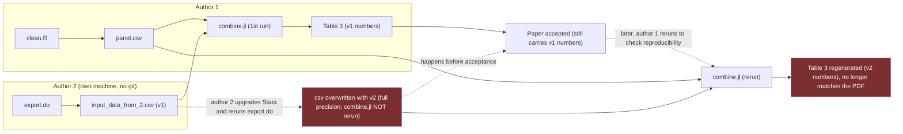
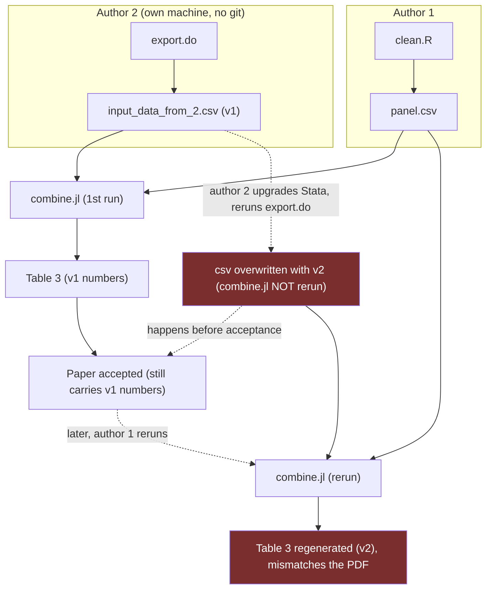
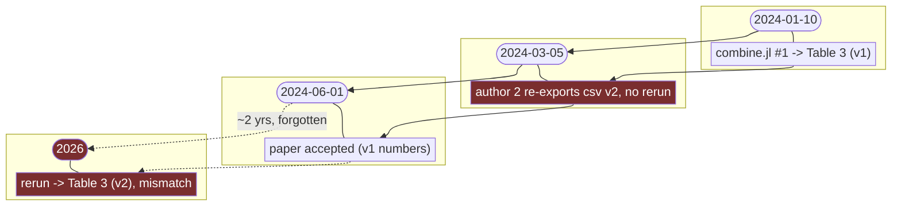
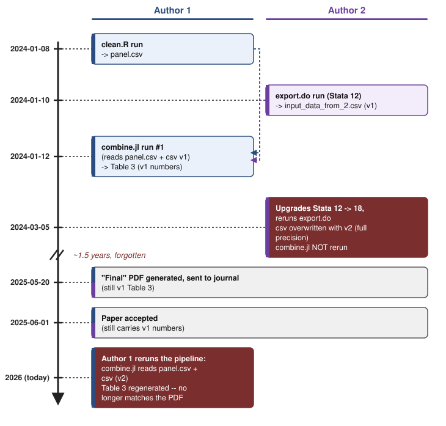

# DeadReckoning presentation demo

Seven segments, ~14 minutes total. All drive the real pipeline
(`run_pipeline` / `deadreckoning run`), not hand-built objects. The first
three rig a broken/renamed path that crashes and gets fixed live by an
LLM; the fourth and fifth are the harder case — nothing crashes, the
numbers are just silently wrong; the sixth is three independent static
leads surfaced before anything runs, in a package mixing three
languages; the seventh is a filename lead on confidential data, where
the fix loop refuses to run at all.

Every script below also takes `--pause`, in addition to `--terse`:
waits for Enter before each narrated step instead of printing the whole
run straight through — the flag to use when actually presenting one of
these live, so the audience isn't reading a wall of scrolled-past text.
(`--terse` and `--pause` compose but are redundant together — terse mode
skips most of the `step()` narration `--pause` would otherwise wait on.)

## 1. Toy package — `run_demo.py`

Fake paper (`toy_paper/`) with three rigged problems: the author claims
R-only (README says so too) but the actual code is Stata; the Stata
script silently reads an undeclared second CSV (`region_boost.csv`) never
mentioned in the README; and the script has a typo'd input filename
(`survey_data.csv` instead of `survey.csv`) that only surfaces as a real
runtime failure — this is the one the LLM fix loop actually fixes.

```bash
python3 demo/run_demo.py                     # interactive — you play the author, live
python3 demo/run_demo.py --non-interactive   # scripted answers, straight through, no pauses (CI)
python3 demo/run_demo.py --skip-docker       # acts 1-3 only, no Stata license needed
python3 demo/run_demo.py --terse             # one line per step instead of full narration
```

Act 1 is the real intake questionnaire (`deadreckoning.intake.questionnaire()`)
answered live at the keyboard by whoever's presenting — you play the author
and claim the project is R-only, same as the real README says. `--non-interactive`
swaps in canned scripted answers instead, so the demo still runs unattended for
CI/verification without a human typing.

Act 3 calls each pipeline step directly (GRAPH, CAPTURE, SCAN, RESOLVE, ASK,
FIX, RUN, VALIDATE, CLEAN, DOCKER) — the same functions
`orchestrator.run_pipeline()` calls internally, just narrated one at a time
instead of hidden behind a single call, with a one-line explanation of what
each step does and the actual generated artifacts (DATA-EXHIBIT-MAP.md,
Dockerfile, etc.) printed as they're produced.

Shows: intake questionnaire catching the language lie, GRAPH tracing the
undeclared file straight to the exhibit it feeds, then a full run —
native Stata execution fails on the typo'd path, and **this is where an
LLM (Claude, live API call) actually does the thinking**: it's handed
the failing stderr/log excerpt plus a directory listing, reasons about
which file was meant, and proposes a `rewrite_path` fix that gets applied
and re-run natively. Everywhere else in the pipeline (SCAN, GRAPH,
RESOLVE, intake contradictions) is deterministic — the LLM only engages
when a native run actually fails and no static/deterministic fix applies.
Then Docker build/run against a pre-built private Stata image
(`dataeditors/stata18_5-mp:2025-02-26` by default) if not skipped.

Needs `ANTHROPIC_API_KEY` set for the LLM fix-loop act to actually call
Claude — without it, the dispatcher silently returns no fix and the demo
reports "still failing" for that step.

Needs for the Docker path: `$STATA_LICENSE_PATH` set to a valid
`stata.lic`, and that base image built locally already (falls back to
`--skip-docker` automatically if the license isn't set).

## 2. Real package — `run_demo_bus_locations.py`

One-table slice of a real JPE-style package (BusLocations, Marra and
Oswald) with real tender-auction data. Two rigged problems: the script
hardcodes an absolute Dropbox path instead of using the real package's
`paths()`/`R_DROPBOX` convention (a common deadline-crunch slip); and
the underlying data file was renamed on disk (`tenders_edited.csv` ->
`tenders_edited_final.csv`) without anyone updating the script or
README — a classic "which version is the real one" slip.

```bash
python3 demo/run_demo_bus_locations.py           # full step-by-step narration
python3 demo/run_demo_bus_locations.py --terse   # one line per step
```

Same narrated-step-by-step treatment as segment 1: each real pipeline
function (GRAPH, CAPTURE, SCAN, RESOLVE, ASK, FIX, RUN, VALIDATE, CLEAN)
called directly and explained as it runs, instead of one call to
`run_pipeline()`. No Docker step here (this fixture always runs with
`skip_docker=True`).

Shows: SCAN flagging the hardcoded path, GRAPH tracing the exhibit to its
data input, RESOLVE deterministically rewriting the absolute path to a
project-relative one — which still 404s natively, because RESOLVE only
knows the basename the script asked for, not that the file was renamed.
**That's where Claude (live API call) does the actual reasoning**: given
the failing stderr and a directory listing, it identifies the renamed
file and proposes the fix, which gets applied and re-run natively to
reproduce the real table with real numbers. No Docker in this segment —
the real package pulls in osrm/tidygeocoder (network calls) and
multi-hour precomputed distance files; this slice is scoped to what runs
in seconds.

Needs `ANTHROPIC_API_KEY` for the LLM fix-loop act, same as segment 1.

## 3. Real package — `run_demo_landuse.py`

One-script, one-data-file slice of a real, published, own-authored
replication package: Oswald, *Land Use, Structural Change and Urban
Expansion* (REStud), github.com/floswald/LandUse-REStud, data on Zenodo.
The full package is Julia + R + Stata across many real-world data
sources (GHS, Copernicus CLC, INSEE, Schauberger yields, Shlomo Angel,
IGN, CASD-cleared secure-enclave aggregates) — this slice is scoped to
one self-contained Stata script, `code/stata/figure1.do`, and its one
real data input, `FRA_base.dta` (French land-use/employment shares,
1806-2018), producing the paper's actual Figure 1.

One rigged problem, same "deadline-crunch slip" pattern as segment 2:
the data file was renamed on disk (`FRA_base.dta` -> `FRA_base_v2.dta`)
without the script being updated. Unlike segment 2, there's no
hardcoded/external path here — the script's `use "data/raw/FRA_base.dta"`
is a plain project-relative path, so SCAN/RESOLVE see nothing to flag or
rewrite; the native run just 404s.

```bash
python3 demo/run_demo_landuse.py           # full step-by-step narration
python3 demo/run_demo_landuse.py --terse   # one line per step
```

Shows: DETECT returning a clean, not-restricted pass (CASD/not-shared
data is excluded from this slice — contrast with what a full-package
scan would flag), then a full run — native Stata execution fails on the
renamed file, and **this is where Claude (live API call) does the actual
reasoning**: handed the failing stderr and a directory listing, it spots
the rename and proposes a `rewrite_path` fix, which gets applied and
re-run natively to reproduce the real Figure 1 from real French land-use
data. No Docker in this segment — Stata-only, one script, seconds to run.

Needs `ANTHROPIC_API_KEY` for the LLM fix-loop act, same as segments 1-2.
Needs a local Stata install for the native RUN step.

## 4. Synthetic package — `run_demo_coauthor_drift.py`

Every demo above rigs a broken/renamed file path that *crashes* — exit
code 1, a real stderr, something an LLM can reason about and fix. This
one is the harder, quieter failure: nothing crashes. Two coauthors, no
version control:



Same diagram, top-down instead of left-right — narrower, fits a 16:9
slide panel better than the wide version above (keep both; this one is
for slides):



Third variant: same story, compressed to a literal timeline — dates
down the left border as a continuous vertical arrow, events down the
right, so the real multi-year gap between "paper accepted" and "nobody
notices" is the point of the picture, not an afterthought (keep this
one too; narrowest of the three, built for a slide corner):



Fourth variant, different technology — hand-written SVG instead of
Mermaid (`demo/make_coauthor_drift_timeline.py` generates
`demo/coauthor_drift_timeline.svg`). Mermaid's flowchart engine gives
no control over a real axis/tick visual, wraps node labels at a fixed
pixel width regardless of content, and has no notion of "one column per
actor" — the wrong tool once the ask is specifically "an arrow down the
left with tick marks at dates, and I need to see who did what." This one
draws a literal timeline: a continuous vertical arrow with tick marks at
each real date, event boxes laid out in three columns (time / Author 1 /
Author 2 — a colored stripe and header per author make it unambiguous
whose action each box is), an explicit axis-break glyph where the long
gap is compressed, and red fill marking where it silently went wrong:



```bash
python3 demo/make_coauthor_drift_timeline.py   # regenerate after editing dates/labels
```

`code/clean.R` (author 1) writes `data/panel.csv`. Author 2's
`export.do` — which never lives in this package, see
`demo/coauthor_drift_private/` — writes `data/input_data_from_2.csv`, a
region-weight file. `code/combine.jl` (author 1) reads both and writes
the paper's actual Table 3: a weighted average of regional revenue.

The rig: author 2's original `.do` file used `outsheet`, which (with no
display format ever set) truncates exported numbers to 2 decimals. At
some point *before* the paper is accepted, author 2 upgrades their
Stata version and modernizes the script to `export delimited` — the
recommended replacement since Stata 13 — still with no display format
set, so the same underlying weights now export at full double precision
instead of 2 decimals. Same data, same logic, just a different
command's default. Confirmed, not invented:
[statalist.org/.../1577196](https://www.statalist.org/forums/forum/general-stata-discussion/general/1577196-export-excel-and-decimal-places),
[stata.com/statalist/2011-01/msg00310](https://www.stata.com/statalist/archive/2011-01/msg00310.html),
[stata.com/statalist/2010-12/msg00903](https://www.stata.com/statalist/archive/2010-12/msg00903.html).
Author 2 reruns the script and drops the re-exported csv into the
shared Dropbox "to tidy up." But the downstream consumer of that file,
`combine.jl`, is never rerun — so what actually goes into the accepted
paper is `combine.jl`'s old output, already out of sync with the csv
sitting on disk, well before anyone submits anything.

```bash
python3 demo/run_demo_coauthor_drift.py           # full step-by-step narration
python3 demo/run_demo_coauthor_drift.py --terse   # one line per step
```

Shows: DETECT, SCAN, RESOLVE, ASK, FIX, RUN, and VALIDATE all pass
clean — exit 0, the exhibit exists on disk, nothing to flag. That's the
whole point: by every check the other three demos exercise, this run is
fine. The new **FIDELITY** step (`check_exhibit_fidelity`, added
alongside this demo) is what actually catches it — it compares the
regenerated Table 3 against the published reference shipped in the
fixture, and on mismatch walks the dependency chain (via
`graph.script_order` and `DataFile.produced_by`, both now real rather
than the aspirational/always-empty fields they were before this demo)
to name the upstream files responsible. Since author 2's machine has no
git, the only evidence is filesystem mtime — reported explicitly as a
**lead, not proof** (Dropbox sync, zip/unzip, and scp all rewrite
mtimes without a real edit happening). On a git-tracked package, the
same check instead calls `git log --follow` and reports an exact
commit, date, and author.

No LLM fix-loop act in this demo — there's nothing to fix automatically;
the point is surfacing the divergence and naming a suspect for the
author to go ask about. No Docker, no API key needed.

The "correct" fix for all of this is putting the whole pipeline under
git with CI checking every exhibit on every push — but that's not a
realistic ask for most social scientists. This check and its mtime
fallback exist for the world as it actually is: no git, no CI, just a
shared Dropbox folder.

## 5. Fan-out fidelity + chain drift — `demo/run_demo_landuse_fanout.py`

Both silent-drift shapes from the deck, live, in one run: segment 4's
chain (a downstream consumer that never reran), plus a parallel fan-out
at scale — one real shared data input, two real Stata scripts, six real
exhibits. Extends `demo/landuse_real/` (untouched by this demo) with a
second script, `code/stata/generatethetas.do`, which reads the same
`data/raw/FRA_base.dta` as `code/stata/figure1.do`, plus a third,
synthetic script, `code/julia/combine_theta_summary.jl` — fabricated for
this demo, not part of the real published package (see
`demo/landuse_fanout/README.md`) — which reads `generatethetas.do`'s
output and a coauthor-supplied decade weighting scheme to produce a
seventh exhibit, `TableTheta.tex`.

Two independent rigs:

1. **Fan-out** (baked into `reference/` ahead of time): a provider
   restatement of two 1950 observations in `FRA_base.dta`.
   `generatethetas.do` was rerun after the restatement, so its three
   reference exhibits (`figureA3.pdf`, `figure7.pdf`, `figureA4.pdf`)
   already reflect the current data. `figure1.do` was believed
   unaffected and never rerun, so its three reference exhibits
   (`figure1.pdf`, `figureA2a.pdf`, `figureA2b.pdf`) still reflect the
   pre-restatement data.
2. **Chain** (performed live by the demo script, like segment 4): a
   coauthor's private export script modernizes `outsheet` ->
   `export delimited` with no display format set, silently leaking full
   double-precision decade weights into `data/decade_weights.csv`.
   `combine_theta_summary.jl`, the downstream consumer, is never rerun
   before the swap, so `TableTheta.tex` is stale too — for a completely
   different reason than the other three mismatches.

Every script still exits 0, every exhibit still lands on disk — nothing
crashes.

```bash
python3 demo/run_demo_landuse_fanout.py           # full step-by-step narration
python3 demo/run_demo_landuse_fanout.py --terse   # one line per step
```

Shows: DETECT, SCAN, RESOLVE, ASK, FIX, RUN, and VALIDATE all pass
clean on all seven exhibits. **FIDELITY** is the only check that tells
them apart, and names two different suspects for two different reasons
in the same run: `figure1.do`'s three exhibits implicate only
`data/raw/FRA_base.dta`; `TableTheta.tex` implicates both
`data/raw/FRA_base.dta` (a real but incidental upstream link —
`combine_theta_summary.jl`'s input is itself produced by
`generatethetas.do`) and `data/decade_weights.csv` (the actual cause) —
without ever flagging the three `generatethetas.do` exhibits that are
actually fine. See `demo/landuse_fanout/README.md` for exactly how both
rigs were built and verified.

No LLM fix-loop act in this demo either — same as segment 4, there's
nothing to fix automatically, only a divergence to surface and a
suspect to name. No Docker, no `ANTHROPIC_API_KEY` needed.

Needs a local Stata install for the native RUN step, same as segment 3,
plus a local Julia install with CSV.jl/DataFrames.jl.

## 6. Rcpp mixed-language package — `run_demo_rcpp_rng.py`

Different failure shape again: three languages (Stata, R, Rcpp/C++) in
one small package, three independent reproducibility gaps, all found
*statically, before any native run even starts* — not one crash, not one
exhibit fidelity mismatch to trigger an investigation.

`code/stata/prep_survey.do` picks one "anchor" respondent per region
from a household survey; `code/simulate.R` reads that anchor and calls a
compiled Rcpp routine, `src/shocks.cpp`, to simulate income shocks
around it, producing Table 1 and Figure 1.

```bash
python3 demo/run_demo_rcpp_rng.py           # full step-by-step narration
python3 demo/run_demo_rcpp_rng.py --terse   # one line per step
```

Three gaps, each its own check, each its own `.md` file:

1. **SORT-CHECK (new)** — `prep_survey.do` sorts on a non-unique key
   (`sort region`, three respondents per region) with no `, stable` and
   no `set sortseed`, then picks "first observation per group"
   (`by region: keep if _n==1`). Stata's default sort breaks ties with
   an internal random tiebreaker, not guaranteed stable across runs,
   Stata editions, or machines — confirmed via Stata's own `sortseed`
   docs and `help sort`, not invented. The new `sort_check.py` this demo
   exists to showcase.
2. **MIXED-LANGUAGE-CHECK (existing)** — `src/shocks.cpp` is
   Rcpp-embedded C++ with no `src/Makevars` anywhere in the package;
   `sourceCpp()` auto-compiles it with R's default flags regardless, so
   this doesn't crash — but the file's own comment records the author's
   personal machine actually built it with an unrecorded
   `-O3`. Non-blocking, same posture as every other check in
   this module.
3. **RNG-CHECK (existing, extended for this demo)** — `shocks.cpp` calls
   `Rcpp::rnorm()`, which draws from R's own RNG stream, with no
   `set.seed()` anywhere upstream. `rng_check.py`'s C++ patterns
   previously only caught `std::rand()`/`<random>` engines; Rcpp/R-API
   RNG patterns (`Rcpp::rnorm`, `R::rnorm`, `norm_rand`, `unif_rand`, …)
   are new, specifically for this case.

Also shows **COMPILE-CHECK**, the blocking "compiled source with no
build script" gap, correctly staying silent here: `compile_check.py` now
exempts Rcpp-embedded sources (`// [[Rcpp::...]]` / `#include <Rcpp.h>`)
from that gap, since `sourceCpp()` genuinely is the build step — without
that fix, this fixture would halt at ASK before ever reaching the three
checks above.

Of the three gaps, only the missing seed is live in this fixture — RUN
regenerates Table 1 with a fresh, different `Rcpp::rnorm()` draw every
single time, so **FIDELITY** always catches a mismatch against the
baked-in reference. But FIDELITY's own mtime-based localization points
at two upstream files that never actually changed content — pure noise,
because the real cause isn't an upstream file at all. The actual
explanation is the RNG-CHECK finding, already written to disk before
this run even started. See `demo/rcpp_rng/README.md` for why the other
two gaps are real but deliberately not made live in the same run (mixing
more than one numeric cause into one exhibit would make the mismatch
impossible to attribute to anything specific).

No LLM fix-loop act — nothing here crashes. No Docker, no
`ANTHROPIC_API_KEY` needed. Needs a local Stata install, R with `Rcpp`
and `haven`, and a C++ compiler for the native RUN step.

## 7. Restricted/confidential data — `run_demo_restricted.py`

Made-up household-income survey, one real bug, one filename lead.
`code/analysis.py` reads `data/survey_confidential.csv` — the filename
alone trips DETECT's heuristic ("confidential"), no file content opened
to make that call. Before #27, that aborted the whole pipeline: no
working copy, nothing downstream ran. Now it keeps going —
GRAPH/CAPTURE/SCAN/RESOLVE/RUN/VALIDATE are all 100%-local already,
restricted or not — with LLM-FIX and ASK hints unconditionally off for
the rest of the run.

```bash
python3 demo/run_demo_restricted.py           # full step-by-step narration
python3 demo/run_demo_restricted.py --terse   # one line per step
```

The script has a real, independent bug — it reads column
`household_income`; the CSV's actual column is `income` — exactly the
kind of thing Claude normally fixes live (segment 1's Act 3). Here the
fix loop refuses to even try: `LLMDispatcher(restricted=True)` is handed
a client that raises `AssertionError` if touched at all, to prove the
refusal happens before `_get_client()`, let alone a prompt, regardless
of whether an API key is set. The run stays failed. The new
`DATA-STRUCTURE-SUMMARY.md` (row counts + column names, never cell
values, never transmitted) already has the one fact — the real column
name — a human author would need to fix this themselves in ten seconds.

Also passes `approve_fn` through to `run_llm_fix_loop` (#28's per-action
approval gate), to show it's wired — but never actually exercised here,
since a restricted dispatcher never proposes a fix for anything to
approve.

No API key needed (the dispatcher never calls out either way), no
Docker, no local interpreter beyond Python's standard library — the
most portable demo of the seven. Fully covered by
`tests/test_demo_restricted.py` in regular CI (not `-m local`).

## Notes

- None of the seven scripts touch `demo/toy_paper/`, `demo/bus_locations_real/`,
  `demo/landuse_real/`, `demo/coauthor_drift/`, `demo/landuse_fanout/`,
  `demo/rcpp_rng/`, or `demo/restricted_data/` directly — the pipeline always
  works on a temp copy, printed as "Working copy" in the output.
- All seven scripts write `DATA-EXHIBIT-MAP.md` into that working copy
  (the generated data availability statement).
