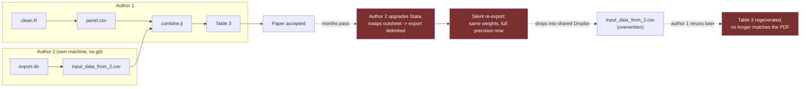

# DeadReckoning presentation demo

Four segments, ~9 minutes total. All drive the real pipeline
(`run_pipeline` / `deadreckoning run`), not hand-built objects. The first
three rig a broken/renamed path that crashes and gets fixed live by an
LLM; the fourth is the harder case — nothing crashes, the numbers are
just silently wrong.

## 1. Toy package — `run_demo.py`

Fake paper (`toy_paper/`) with three rigged problems: the author claims
R-only (README says so too) but the actual code is Stata; the Stata
script silently reads an undeclared second CSV (`region_boost.csv`) never
mentioned in the README; and the script has a typo'd input filename
(`survey_data.csv` instead of `survey.csv`) that only surfaces as a real
runtime failure — this is the one the LLM fix loop actually fixes.

```bash
python3 demo/run_demo.py                     # interactive — you play the author, live
python3 demo/run_demo.py --non-interactive   # scripted answers, straight through, no pauses (CI)
python3 demo/run_demo.py --skip-docker       # acts 1-3 only, no Stata license needed
python3 demo/run_demo.py --terse             # one line per step instead of full narration
```

Act 1 is the real intake questionnaire (`deadreckoning.intake.questionnaire()`)
answered live at the keyboard by whoever's presenting — you play the author
and claim the project is R-only, same as the real README says. `--non-interactive`
swaps in canned scripted answers instead, so the demo still runs unattended for
CI/verification without a human typing.

Act 3 calls each pipeline step directly (GRAPH, CAPTURE, SCAN, RESOLVE, ASK,
FIX, RUN, VALIDATE, CLEAN, DOCKER) — the same functions
`orchestrator.run_pipeline()` calls internally, just narrated one at a time
instead of hidden behind a single call, with a one-line explanation of what
each step does and the actual generated artifacts (DATA-EXHIBIT-MAP.md,
Dockerfile, etc.) printed as they're produced.

Shows: intake questionnaire catching the language lie, GRAPH tracing the
undeclared file straight to the exhibit it feeds, then a full run —
native Stata execution fails on the typo'd path, and **this is where an
LLM (Claude, live API call) actually does the thinking**: it's handed
the failing stderr/log excerpt plus a directory listing, reasons about
which file was meant, and proposes a `rewrite_path` fix that gets applied
and re-run natively. Everywhere else in the pipeline (SCAN, GRAPH,
RESOLVE, intake contradictions) is deterministic — the LLM only engages
when a native run actually fails and no static/deterministic fix applies.
Then Docker build/run against a pre-built private Stata image
(`dataeditors/stata18_5-mp:2025-02-26` by default) if not skipped.

Needs `ANTHROPIC_API_KEY` set for the LLM fix-loop act to actually call
Claude — without it, the dispatcher silently returns no fix and the demo
reports "still failing" for that step.

Needs for the Docker path: `$STATA_LICENSE_PATH` set to a valid
`stata.lic`, and that base image built locally already (falls back to
`--skip-docker` automatically if the license isn't set).

## 2. Real package — `run_demo_bus_locations.py`

One-table slice of a real JPE-style package (BusLocations, Marra and
Oswald) with real tender-auction data. Two rigged problems: the script
hardcodes an absolute Dropbox path instead of using the real package's
`paths()`/`R_DROPBOX` convention (a common deadline-crunch slip); and
the underlying data file was renamed on disk (`tenders_edited.csv` ->
`tenders_edited_final.csv`) without anyone updating the script or
README — a classic "which version is the real one" slip.

```bash
python3 demo/run_demo_bus_locations.py           # full step-by-step narration
python3 demo/run_demo_bus_locations.py --terse   # one line per step
```

Same narrated-step-by-step treatment as segment 1: each real pipeline
function (GRAPH, CAPTURE, SCAN, RESOLVE, ASK, FIX, RUN, VALIDATE, CLEAN)
called directly and explained as it runs, instead of one call to
`run_pipeline()`. No Docker step here (this fixture always runs with
`skip_docker=True`).

Shows: SCAN flagging the hardcoded path, GRAPH tracing the exhibit to its
data input, RESOLVE deterministically rewriting the absolute path to a
project-relative one — which still 404s natively, because RESOLVE only
knows the basename the script asked for, not that the file was renamed.
**That's where Claude (live API call) does the actual reasoning**: given
the failing stderr and a directory listing, it identifies the renamed
file and proposes the fix, which gets applied and re-run natively to
reproduce the real table with real numbers. No Docker in this segment —
the real package pulls in osrm/tidygeocoder (network calls) and
multi-hour precomputed distance files; this slice is scoped to what runs
in seconds.

Needs `ANTHROPIC_API_KEY` for the LLM fix-loop act, same as segment 1.

## 3. Real package — `run_demo_landuse.py`

One-script, one-data-file slice of a real, published, own-authored
replication package: Oswald, *Land Use, Structural Change and Urban
Expansion* (REStud), github.com/floswald/LandUse-REStud, data on Zenodo.
The full package is Julia + R + Stata across many real-world data
sources (GHS, Copernicus CLC, INSEE, Schauberger yields, Shlomo Angel,
IGN, CASD-cleared secure-enclave aggregates) — this slice is scoped to
one self-contained Stata script, `code/stata/figure1.do`, and its one
real data input, `FRA_base.dta` (French land-use/employment shares,
1806-2018), producing the paper's actual Figure 1.

One rigged problem, same "deadline-crunch slip" pattern as segment 2:
the data file was renamed on disk (`FRA_base.dta` -> `FRA_base_v2.dta`)
without the script being updated. Unlike segment 2, there's no
hardcoded/external path here — the script's `use "data/raw/FRA_base.dta"`
is a plain project-relative path, so SCAN/RESOLVE see nothing to flag or
rewrite; the native run just 404s.

```bash
python3 demo/run_demo_landuse.py           # full step-by-step narration
python3 demo/run_demo_landuse.py --terse   # one line per step
```

Shows: DETECT returning a clean, not-restricted pass (CASD/not-shared
data is excluded from this slice — contrast with what a full-package
scan would flag), then a full run — native Stata execution fails on the
renamed file, and **this is where Claude (live API call) does the actual
reasoning**: handed the failing stderr and a directory listing, it spots
the rename and proposes a `rewrite_path` fix, which gets applied and
re-run natively to reproduce the real Figure 1 from real French land-use
data. No Docker in this segment — Stata-only, one script, seconds to run.

Needs `ANTHROPIC_API_KEY` for the LLM fix-loop act, same as segments 1-2.
Needs a local Stata install for the native RUN step.

## 4. Synthetic package — `run_demo_coauthor_drift.py`

Every demo above rigs a broken/renamed file path that *crashes* — exit
code 1, a real stderr, something an LLM can reason about and fix. This
one is the harder, quieter failure: nothing crashes. Two coauthors, no
version control:



`code/clean.R` (author 1) writes `data/panel.csv`. Author 2's
`export.do` — which never lives in this package, see
`demo/coauthor_drift_private/` — writes `data/input_data_from_2.csv`, a
region-weight file. `code/combine.jl` (author 1) reads both and writes
the paper's actual Table 3: a weighted average of regional revenue.

The rig: author 2's original `.do` file used `outsheet`, which (with no
display format ever set) truncates exported numbers to 2 decimals.
Months after the paper is accepted, author 2 upgrades Stata and
modernizes the script to `export delimited` — the recommended
replacement since Stata 13 — still with no display format set, so the
same underlying weights now export at full double precision instead of
2 decimals. Same data, same logic, just a different command's default.
Confirmed, not invented:
[statalist.org/.../1577196](https://www.statalist.org/forums/forum/general-stata-discussion/general/1577196-export-excel-and-decimal-places),
[stata.com/statalist/2011-01/msg00310](https://www.stata.com/statalist/archive/2011-01/msg00310.html),
[stata.com/statalist/2010-12/msg00903](https://www.stata.com/statalist/archive/2010-12/msg00903.html).
Author 2 drops the re-exported csv into the shared Dropbox "to tidy up."
Nobody reruns the paper.

```bash
python3 demo/run_demo_coauthor_drift.py           # full step-by-step narration
python3 demo/run_demo_coauthor_drift.py --terse   # one line per step
```

Shows: DETECT, SCAN, RESOLVE, ASK, FIX, RUN, and VALIDATE all pass
clean — exit 0, the exhibit exists on disk, nothing to flag. That's the
whole point: by every check the other three demos exercise, this run is
fine. The new **FIDELITY** step (`check_exhibit_fidelity`, added
alongside this demo) is what actually catches it — it compares the
regenerated Table 3 against the published reference shipped in the
fixture, and on mismatch walks the dependency chain (via
`graph.script_order` and `DataFile.produced_by`, both now real rather
than the aspirational/always-empty fields they were before this demo)
to name the upstream files responsible. Since author 2's machine has no
git, the only evidence is filesystem mtime — reported explicitly as a
**lead, not proof** (Dropbox sync, zip/unzip, and scp all rewrite
mtimes without a real edit happening). On a git-tracked package, the
same check instead calls `git log --follow` and reports an exact
commit, date, and author.

No LLM fix-loop act in this demo — there's nothing to fix automatically;
the point is surfacing the divergence and naming a suspect for the
author to go ask about. No Docker, no API key needed.

## Notes

- None of the four scripts touch `demo/toy_paper/`, `demo/bus_locations_real/`,
  `demo/landuse_real/`, or `demo/coauthor_drift/` directly — the pipeline
  always works on a temp copy, printed as "Working copy" in the output.
- All four scripts write `DATA-EXHIBIT-MAP.md` into that working copy
  (the generated data availability statement).
