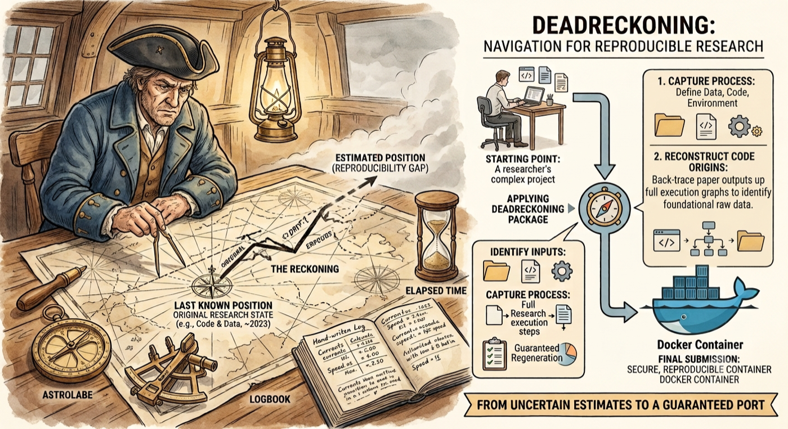

## Dead reckoning {#sec-title}

> *(navigation)*: estimating your current position from a previously known
> position, then accounting for speed, direction, and elapsed time —
> without GPS. Accurate fixes require cross-referencing multiple imperfect
> signals. **The further you've drifted, the harder the reckoning.**

<br>

::: {.fragment}
A replication package is the same problem. The paper is the known
position. The code on disk is the drift.
:::

---

## The moment this tool is for {#sec-moment}

::: {.incremental}
1. A paper takes years to write. Code accumulates across machines,
   collaborators, software updates.
2. Nobody reruns everything from scratch on a regular basis — there is
   always a more pressing deadline.
3. The paper is **accepted.** The journal asks for a replication package.
4. The author tries to rerun it. 🤔 It does not work anymore.
:::

::: {.fragment}
Moved files. Changed package versions. A figure nobody remembers how to
regenerate. A table that doesn't trace to any script.
:::

## What actually went wrong {#sec-picture}

{fig-align="center" height="520"}

## Why this is hard by hand {#sec-why-hard}

The author knows the project better than anyone, but:

::: {.incremental}
- Which package version was installed, where a data file was saved,
  which script produced a given figure — never written down, because it
  seemed obvious at the time.
- Recovering it means cross-referencing file timestamps, code history,
  output files, and the paper itself — **simultaneously.**
- Tedious and error-prone for a person.
:::

::: {.fragment}
Tractable for a tool that can read all of those sources **at once** and
ask focused questions only about what it genuinely can't determine.
:::

## Prior art {#sec-priorart}

| Tool | What it does | Why it's not enough |
|------|--------------|----------------------|
| `repo2docker` (Binder) | Auto-detects config, builds image | Notebook-world assumptions; needs declared config; no fix loop |
| `containerit` (Nüst) | Introspects an R session → Dockerfile | R-only; needs a live clean session |
| rocker + Posit PM | Dated CRAN snapshots | Only works *if* you already used it — most don't |
| `dataeditors/stata` | BYO-license Stata image | A base image, not a tool that adapts to a messy project |

::: {.fragment}
Nothing here **reads a messy project, asks what it can't infer, and
fixes what it can.**
:::

---

## Core design principle {#sec-principle}

> "No lockfile" ≠ "the information is gone."

::: {.fragment}
Most of what the author can't remember is **still on their disk.**
:::

::: {.incremental}
- Read the live environment first — `renv::snapshot()`, `pip freeze`,
  `Pkg.status()`, `creturn list` — before asking anything.
- No live environment? Use timestamps to find a *date*, which maps to a
  known software snapshot (Posit PM, Julia registry, conda channel).
- Parse the code for the package list. **Package set + date ≈ versions.**
:::

::: {.fragment}
**The primary output is a working replication package — not a Docker
image.** Docker freezes the environment at the end, once it already runs.
:::

## Before touching a single file {#sec-confidentiality-gate}

This agent is powered by an LLM running on remote servers. Code, paths,
and summaries get sent over the internet. For most projects, fine. For
restricted data — DUAs, IRB protocols, GDPR, NDAs — it may be **illegal**,
regardless of what the agent does with it.

::: {.callout-important}
So before opening any file, before scanning any directory, before making
the working copy, the agent asks one question:

> "Does this project use data that is confidential, restricted, or
> covered by a DUA, IRB protocol, or NDA?"
:::

::: {.fragment}
Yes → **restricted mode** for the rest of the session.
:::

::: {.fragment}
A filename like `census` or `psid` doesn't *prove* restricted data — plenty
of legitimate public-use extracts are named that way. So if the author
said no but the scan later turns up `restricted`, `nda`, `hipaa`,
`census`, `psid`, a DUA document, etc., the agent doesn't silently flip
the switch — it **asks again, specifically:**

> "I found something that may indicate restricted data. Before I read
> any data files, please confirm: is this covered by a DUA or IRB
> protocol?"

Only an explicit "yes" turns restricted mode on. No guess is trusted on
its own.
:::

## Restricted mode, concretely {#sec-restricted-mode visibility="uncounted"}

| Content type | Sent to the AI service? |
|---|---|
| Code files, file paths, filenames/sizes, variable *names* | **Yes** |
| Data file **contents** — any row, any value | **No** |
| Logs / `.Rhistory` | Filtered locally first — numeric arrays, row counts stripped |
| Figures / tables | Shape and type only — not real statistics |

::: {.fragment}
Data-structure summaries (`nrow`, `names`, `describe`) are generated by a
**local script**, run on the author's machine — only the summary travels.
:::

## The 9 things the agent can't find on its own {#sec-minreq visibility="uncounted"}

::: {.incremental}
1. Where `paper.tex` / `appendix.tex` live
2. Where code and data live
3. Where existing docs live
4. Where produced outputs live
5. When the output was last successfully produced
6. Proprietary software in use (Stata / MATLAB) + license
7. Restricted or confidential data — asked **first**, see previous slide
8. Rough expected runtime
9. Target journal / submission standard
:::

::: {.fragment}
Everything else — package versions, dependency lists, platform details —
is **reconstructed**, not asked.
:::

## The pipeline {#sec-pipeline}

```
DETECT → GRAPH → CAPTURE → SCAN → RESOLVE → ASK → FIX → LLM-FIX
   → RUN (native) → VALIDATE (native) → CLEAN → GENERATE
   → BUILD (docker) → VALIDATE (docker) → DELIVER
```

| Phase | Steps | What happens |
|---|---|---|
| **1. Understand** | DETECT, CAPTURE, SCAN, GRAPH | Read the project; trace every exhibit in `paper.tex` back to a script and a data file |
| **2. Repair** | ASK, RESOLVE, FIX, LLM-FIX | Ask only what the disk couldn't answer; fix deterministically; hand a real failure to an LLM only when nothing else applies |
| **3. Validate (native)** | RUN, VALIDATE | Delete all outputs, rerun from scratch, confirm every exhibit regenerates |
| **4. Containerize** | CLEAN, GENERATE, BUILD, VALIDATE | Docker is the *last* step — only once the native run already passes |
| **5. Deliver** | DELIVER | Package + README + `data-manifest.csv` + `AGENT_REPORT.md` |

::: {.fragment}
VALIDATE only checks an exhibit **exists.** Not that its content still
matches what was published — that gap has a name, coming up: **FIDELITY.**
:::

::: {.notes}
Only one step in this entire pipeline calls a live LLM: LLM-FIX, and only
when the native run has actually failed and no deterministic fix applies.
Everything else — GRAPH, SCAN, RESOLVE, ASK — is regex and file I/O.
:::

## GRAPH: the backbone of the whole pipeline {#sec-graph visibility="uncounted"}

The `.tex` source is the **only** authoritative list of what the paper
actually uses.

```
paper.tex → exhibit file (fig3b.pdf, tab2.tex) → script → data → raw source
```

::: {.incremental}
- Exhibit exists, script writes to that exact path → good, add to graph.
- Exhibit exists, **no script writes it** → flag: "I found `fig3b.pdf`
  but no script that writes it. How was this produced?"
- Numbers typed straight into `.tex`, no `\input{}` → flag: likely
  pasted from output, can't be checked by any automated replication.
- Exhibit referenced but **doesn't exist at all** → serious gap.
:::

---

## Three packages, one failure pattern {#sec-demos-intro}

Every demo below drives the **real pipeline** — `deadreckoning run` — not
a hand-built mock. Three rig a broken or renamed path that **crashes**;
a fourth and fifth (later) don't crash at all.

::: {.incremental}
1. **Toy paper** — author claims R-only, code is actually Stata; an
   undeclared second data file; a typo'd filename that crashes the run.
2. **BusLocations** *(real JPE-style package, Marra & Oswald)* — a
   hardcoded Dropbox path; the underlying file renamed on disk.
3. **LandUse** *(real, published, REStud)* — a plain project-relative
   path, nothing to flag statically — yet the file was renamed anyway.
:::

::: {.fragment}
In each case: the native run fails for a real reason, and **Claude — a
live API call — reads the actual stderr and proposes the fix.**
:::

## Demo 1 — Toy package {#sec-demo1-setup}

::: {.columns}
::: {.column width="55%"}
**Rigged problems**

- README says R-only — code is actually Stata
- Stata script silently reads an undeclared `region_boost.csv`
- Typo'd filename: `survey_data.csv` instead of `survey.csv`
:::
::: {.column width="45%"}
```
toy_paper/
├── code/analysis.do
├── data/
│   ├── region_boost.csv
│   └── survey.csv
├── paper.tex
├── README.md
└── tables/table1.tex
```
:::
:::

::: {.fragment}
Act 1 is the **real intake questionnaire** — answered live, at the
keyboard, by whoever is presenting. You play the author. You claim
R-only, same as the README.
:::

## Demo 1 — toy package {#sec-demo1-run}

::: {.content-visible when-profile="live"}
::: {.callout-tip}
## 🎥 LIVE — play the author

```bash
cd demo
python3 run_demo.py --skip-docker
```

Act 1: answer the intake questions yourself — claim the project is
R-only. Watch GRAPH catch the undeclared file, then the native Stata
run fail on the typo'd path, then Claude read the stderr and fix it.
:::

Needs `$ANTHROPIC_API_KEY` set for the fix-loop act. ~4–5 min.

::: {.notes}
If the live run stalls (API latency, a typo in the live-typed answers),
don't fight it on stage — fall back to the recorded cast (cast profile
deck, same section) and keep narrating over it.
:::
:::

::: {.content-visible when-profile="cast"}
```{=html}
<link rel="stylesheet" href="offline-assets/asciinema-player/asciinema-player.css">
<div id="cast-toy" style="max-width:100%"></div>
<script src="offline-assets/casts/toy.js"></script>
<script src="offline-assets/asciinema-player/asciinema-player.min.js"></script>
<script>AsciinemaPlayer.create(window.CAST_TOY_DATA_URL, document.getElementById('cast-toy'), {cols:100, rows:28});</script>
```
:::

## Demo 2 — BusLocations {#sec-demo2-setup}

One-table slice of a real JPE-style package (Marra & Oswald,
tender-auction data).

::: {.incremental}
- Script hardcodes an absolute Dropbox path instead of the package's
  own `paths()` / `R_DROPBOX` convention — a classic deadline-crunch slip.
- The underlying data file was **renamed on disk**:
  `tenders_edited.csv` → `tenders_edited_final.csv`, without the script
  or README being updated.
- SCAN flags the hardcoded path. RESOLVE rewrites it to project-relative.
  **It still errors** — RESOLVE only knows the basename asked for, not
  that the file moved.
:::

::: {.fragment}
Same move as demo 1: Claude reads the stderr + a directory listing,
spots the rename, proposes the fix, re-runs natively to reproduce the
real table with real numbers.
:::

## Demo 2 — BusLocations {#sec-demo2-run}

::: {.content-visible when-profile="live"}
::: {.callout-tip}
## 🎥 LIVE

```bash
cd demo
python3 run_demo_bus_locations.py
```

No Docker in this segment. Needs `$ANTHROPIC_API_KEY`. ~2–3 min.
:::
:::

::: {.content-visible when-profile="cast"}
```{=html}
<div id="cast-bus" style="max-width:100%"></div>
<script src="offline-assets/casts/bus.js"></script>
<script src="offline-assets/asciinema-player/asciinema-player.min.js"></script>
<script>AsciinemaPlayer.create(window.CAST_BUS_DATA_URL, document.getElementById('cast-bus'), {cols:100, rows:28});</script>
```
:::

## Demo 3 — LandUse {#sec-demo3-setup}

One script, one data file, from a real published package: Oswald,
*Land Use, Structural Change and Urban Expansion* (REStud). The full
package is Julia + R + Stata across GHS, Copernicus, INSEE, CASD secure
enclaves — this slice is one self-contained Stata script,
`figure1.do`, and its real input, `FRA_base.dta`.

::: {.incremental}
- The data file was renamed: `FRA_base.dta` → `FRA_base_v2.dta` —
  same slip as demo 2, but this time there is **no hardcoded or
  external path to flag.** `use "data/raw/FRA_base.dta"` is already a
  plain project-relative path.
- SCAN and RESOLVE see **nothing to rewrite.** The native run just errors.
:::

::: {.fragment}
This is the point: a static scan cannot catch a rename behind a clean
relative path. Only an actual run — and an LLM reading the actual
failure — catches it. Fixed, re-run, **reproduces the paper's real
Figure 1** from real French land-use data.
:::

## Demo 3 — LandUse {#sec-demo3-run}

::: {.content-visible when-profile="live"}
::: {.callout-tip}
## 🎥 LIVE

```bash
cd demo
python3 run_demo_landuse.py
```

Needs `$ANTHROPIC_API_KEY` and a local Stata install. ~2 min.
:::
:::

::: {.content-visible when-profile="cast"}
```{=html}
<div id="cast-landuse" style="max-width:100%"></div>
<script src="offline-assets/casts/landuse.js"></script>
<script src="offline-assets/asciinema-player/asciinema-player.min.js"></script>
<script>AsciinemaPlayer.create(window.CAST_LANDUSE_DATA_URL, document.getElementById('cast-landuse'), {cols:100, rows:28});</script>
```
:::

---

## The quiet exception {#sec-drift-intro}

Every demo so far rigs a broken path that **crashes** — exit code 1, a
real stderr, something an LLM can read and fix.

::: {.fragment}
This one doesn't crash. Two coauthors, no version control, no error
anywhere. **DETECT, SCAN, RESOLVE, ASK, FIX, RUN, VALIDATE all pass
clean.** That's the whole point.
:::

## How a correct run goes silently wrong {#sec-drift-diagram}



::: {.notes}
Author 2's original `.do` used `outsheet`, which truncates to 2 decimals
with no display format set. Before acceptance, Author 2 upgrades Stata
and modernizes to `export delimited` — the recommended replacement since
Stata 13 — same no-display-format default, so the same weights now
export at full double precision. Same data, same logic, a different
command's default. Author 2 reruns and drops the new csv in the shared
Dropbox "to tidy up" — but `combine.jl`, the downstream consumer, is
never rerun. What goes into the accepted paper is already stale, well
before anyone submits anything.
:::

## FIDELITY: the step that actually catches it {#sec-fidelity}

By every check the other three demos exercise, this run is **fine.**
`check_exhibit_fidelity` is the new step that isn't fooled:

::: {.incremental}
- Compares the regenerated Table 3 against the published reference
  shipped in the fixture — a **mismatch.**
- Walks the dependency chain (`graph.script_order`,
  `DataFile.produced_by`) to **name the upstream files responsible.**
- No git on Author 2's machine → only evidence is filesystem mtime,
  reported explicitly as a **lead, not proof** (Dropbox sync, zip/unzip,
  scp all rewrite mtimes without a real edit happening).
- On a git-tracked package: calls `git log --follow` instead, and
  reports an **exact commit, date, and author.**
:::

::: {.fragment}
No LLM fix here — there's nothing to fix automatically. The point is
surfacing the divergence and naming a suspect for the author to go ask.
:::

::: {.fragment}
**Status:** implemented and tested — not yet called by `run_pipeline`
itself. Open question: what reference to compare against by default,
and whether a mismatch should block delivery or just warn.
:::

::: {.fragment}
Does it scale past one exhibit? Demo 5 runs the same check on **six**
real exhibits sharing one upstream input — only three are actually
stale, and FIDELITY has to tell them apart, not flag all six.
:::

## Demo 4 {#sec-demo4-run}

::: {.content-visible when-profile="live"}
::: {.callout-tip}
## 🎥 LIVE — the safe one

```bash
cd demo
python3 run_demo_coauthor_drift.py
```

No API key, no Docker, no Stata license needed (R + Julia only). The
most reliable live demo in the deck — good one to fall back to if 1–3
misbehave.
:::
:::

::: {.content-visible when-profile="cast"}
Not recorded — this one's safe enough to always run live (no API key,
no Docker, no license). See `demo/README.md §4` for the walkthrough if
presenting from the cast-only deck.
:::

## Demo 5 — fan-out {#sec-demo5-run}

Same mechanism as Demo 4, at scale: one real shared input
(`data/raw/FRA_base.dta`), two real Stata scripts, six real exhibits —
and only three of them are actually stale. DETECT through VALIDATE pass
clean on all six; FIDELITY converges all three mismatches on the same
suspect file without ever flagging the three that are fine.

::: {.content-visible when-profile="live"}
::: {.callout-tip}
## 🎥 LIVE — needs Stata

```bash
cd demo
python3 run_demo_landuse_fanout.py
```

No API key, no Docker needed — but needs a local Stata install (native
RUN step), same as Demo 3.
:::
:::

::: {.content-visible when-profile="cast"}
Not recorded — needs a local Stata install to run live. See
`demo/README.md §5` for the walkthrough if presenting from the
cast-only deck.
:::

---

## What the agent hands back {#sec-deliverables}

::: {.columns}
::: {.column width="50%"}
**Replication package**

- Cleaned project, paths relative throughout
- `README` — AEA-format computational requirements, output table, measured runtime
- `data-manifest.csv` — every data file: source, size, status
- `AGENT_REPORT.md` — what was recovered, inferred, changed, and **what couldn't be**
:::
::: {.column width="50%"}
**Docker setup**

- `Dockerfile` — software environment only, **no `COPY` of data**
- `run.sh` / `docker-compose.yml` — attaches the package as a volume
- `.dockerignore` — excludes data dirs, secrets, build files
:::
:::

::: {.fragment}
Data is **never** copied into the image — an absolute rule, enforced by
how the Dockerfile is generated, not by a warning.
:::

## Why Docker is last, not first {#sec-docker-last visibility="uncounted"}

> A broken pipeline wrapped in a Docker image is still a broken pipeline.

::: {.incremental}
- The package must run on the author's own machine, without Docker,
  first. If it can't do that, it's not a replication package — it's a
  black box.
- Stata / MATLAB can't be redistributed in a public image — the
  **license is supplied at run time**, not baked in.
- Apple Silicon: default to `linux/amd64` where proprietary software
  requires it, and say so — don't ship an arm64 image that mysteriously
  fails to install Stata.
:::

## Cleanup, shown before removed {#sec-cleanup visibility="uncounted"}

The dependency graph already does the hard work: start from every
exhibit, walk backward. Everything not reached is a candidate.

::: {.fragment}
> "I found 23 files that aren't needed to reproduce any figure or table...
> these look like they're from earlier stages of the project. For each
> group you can choose: **delete**, **keep** (tell me why), or
> **archive**."
:::

::: {.fragment}
Tone matters: *"looks like an earlier version,"* not *"this is dead
code."* The author spent years on this material. Three choices, not two
— forcing keep/delete makes everyone keep everything.
:::

## How to know it worked {#sec-success}

::: {.callout-note}
## The gate

Master script, outputs deleted first, run **natively** and **inside the
container** with the package attached as a volume — reproduces every
exhibit in the paper.

**Native pass + container pass = done.**
Native fail = the package is broken; Docker cannot fix it.
:::

## Open questions {#sec-open}

::: {.incremental}
- How aggressively to fix versions automatically vs. show the choices
  to the author?
- Caching strategy for repeated builds during the fix loop — x86
  emulation + Stata builds are slow.
- How to check outputs are *correct*, not just that the run completed?
  Partially answered — [[FIDELITY]{.button}](#sec-fidelity) — not yet
  wired into the default run.
- Where does the image go after it's built — out of scope for v1, but
  the question will come up.
:::

## Summary {#sec-summary}

| | |
|---|---|
| **What it's for** | "paper accepted — does it still run?" |
| **What it isn't** | A Docker wrapper. Docker is the *last* step, not the first. |
| **Core move** | Recover from disk before asking the author |
| **Where the LLM engages** | Only after a real native failure, scoped to that stderr |
| **What catches silent drift** | FIDELITY — comparing against a reference, not just "did it run" |
| **Confidentiality** | Asked before any file is opened; restricted mode never sends data values |

<br>

::: {.fragment}
[github.com/floswald/DeadReckoning](https://github.com/floswald/DeadReckoning)
:::

## Backup: language-specific notes {visibility="uncounted"}

- **R** — `library()`/`require()`; `renv.lock` if present; date → Posit
  Package Manager snapshot; rocker base images.
- **Julia** — prefer `Project.toml`/`Manifest.toml`; `using`/`import`
  scan as fallback; lock registry state.
- **Python** — `requirements.txt`/`pyproject.toml`; `import` scan;
  conda vs. pip distinction matters.
- **Stata** — `_config.do` redirects `sysdir` to `code/ado/` and
  installs user-written ado-files there at build time, so `ssc install`
  doesn't silently fetch a current version at replication time.
- **MATLAB** — official `mathworks/matlab` image; `-browser` flag
  requires the author to log in with a licensed account on first run —
  cannot be automated.

## Backup: the synthetic-data fallback {visibility="uncounted"}

When data truly can't be shared, in order of preference:

1. **Access instructions** — restricted but obtainable; `data-access.md`
2. **Run on the author's machine** — documented as the replication method
3. **Data provider certification**
4. **Synthetic substitute** — structure-matched fake data, generated
   entirely on the author's machine (never the real values):
   local script reads real data → structure summary only → LLM writes
   generator code → runs locally → checked locally. No real value
   crosses the network at any point.
